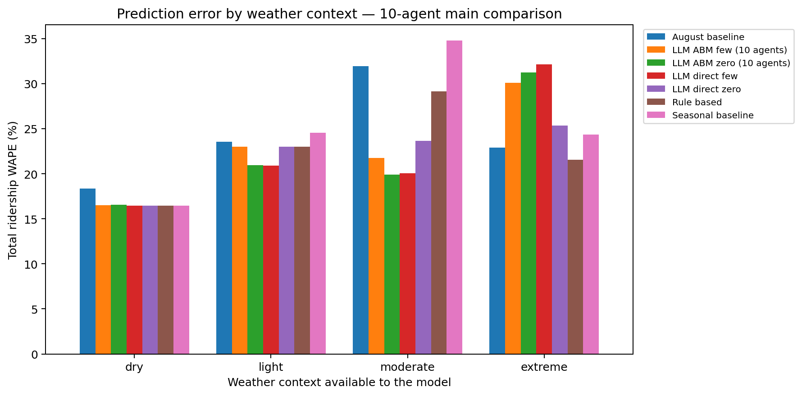
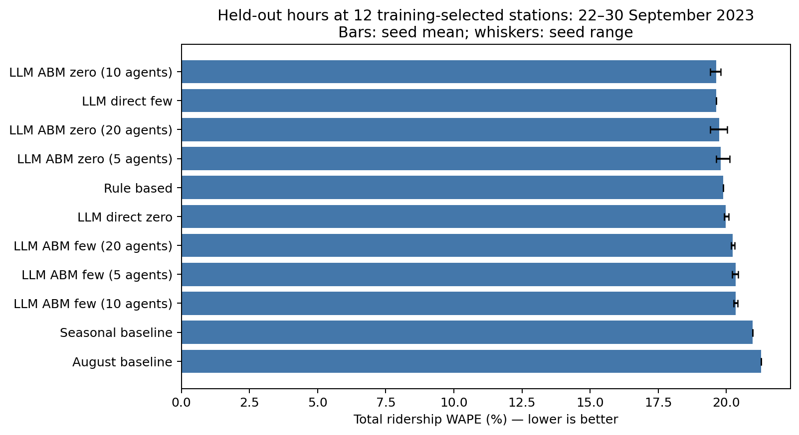
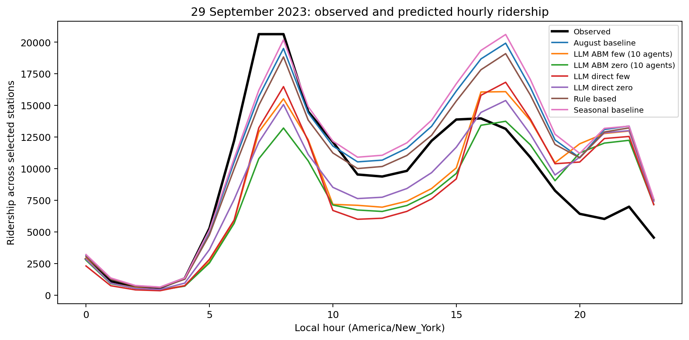
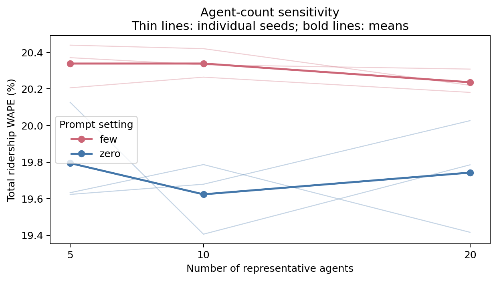

# 首轮实验结果

**LLM agent没有稳定优于简单天气规则。** 按预先选定的10-agent配置，zero-shot整个检验窗口WAPE为19.62%，few-shot为20.34%，天气规则为19.89%。在9月29日暴雨当天，分别为36.19%、36.31%和28.48%。误差越低越好，不能只看整个窗口而忽略事件日。

## 做了什么

12个站点按8月数据预选；8月建正常需求基准，9月1–21日校准，9月22–30日最终检验，共2,591个真实站点小时。四组是学生票、Fair Fare、老人及残障合并票种、其他票种。LLM在不接收真实日期、站名和测试客流的情况下生成群体策略，Mesa逐小时处理出行与推迟。

主实验包含两种基准、天气规则、zero/few整体预测，以及zero/few ×5/10/20 agents ×3次策略重复，共27种模型/配置/重复输出。每站5/10/20个代表代理对应全模型60/120/240个Mesa代理，人口总权重保持不变。few-shot仅有8月普通雨天例子，训练和校准都没有extreme情境。

## 指标

WAPE是逐站逐小时绝对误差之和除以真实客流之和。表中LLM结果为三次独立策略生成的平均，不是三次独立天气事件；各重复明细在CSV中。

| 配置 | 9月22–30日WAPE | 9月29日WAPE |
|---|---:|---:|
| 八月基准 | 21.28% | 29.83% |
| LLM ABM few / 5 agents | 20.34% | 35.58% |
| LLM ABM few / 10 agents | 20.34% | 36.31% |
| LLM ABM few / 20 agents | 20.24% | 36.68% |
| LLM ABM zero / 5 agents | 19.79% | 36.55% |
| LLM ABM zero / 10 agents | 19.62% | 36.19% |
| LLM ABM zero / 20 agents | 19.74% | 37.85% |
| LLM direct few | 19.64% | 37.09% |
| LLM direct zero | 19.97% | 31.64% |
| 天气规则 | 19.89% | 28.48% |
| 季节校正基准 | 20.97% | 31.39% |

## 如何理解

- **few-shot不是自动提升。** 普通雨天的聚合例子不能直接告诉模型极端暴雨下真实需求如何变化。
- **更多代理不保证更准。** 5/10/20是同一假设灵活度分布的不同离散近似，也包含新策略生成的变化，不代表真实乘客人数。
- **极端日判断偏强。** 10-agent zero/few预测的当天总客流分别为正常基准的69.1%/76.4%，实际为81.5%。这个差距说明目前的行为策略对该案例出行减少判断过强，不能将生成的取消或改方式概率当作真实行为比例。
- **基本需求本身很重要。** 季节校正避免把开学差异算作天气影响，但一个倍率仍无法完整重现学生上下学时段和各站周边活动。
- **空间图展示误差。** LLM策略目前全站共享，地图差异来自站点基准和票种组合，不代表LLM学到了站点空间机制。

## 极端情境单独检验

上述整日指标包含9月29日所有小时。若只看6小时累计降雨≥30mm的19个extreme小时，LLM同样更差：

| 模型 | extreme情境WAPE |
|---|---:|
| llm_abm few | 30.12% |
| llm_abm zero | 31.26% |
| rule_based none | 21.53% |

即使当天总量比较接近，小时过程也可能偏离；不能用日总量代替站点小时评分。学生票组的误差仍较高，季节倍率没有完整解决学校时段差异，值得下一轮检查。

## 图表

其余图：群体误差、群体事件响应、站点误差地理位置、推迟返回率敏感性、模型行动概率。行动图是模型设定，没有真实个人决策用来评分。

## API与复现

使用Pro模型，记录25次调用，含预检共82,099个报告token；预算200,000，未使用Lite。完整真实请求与响应在 `results/api_calls.jsonl`。已有策略可通过 `python run_experiment.py --offline` 重放，不消费API；再运行 `python analyze.py --extended` 和 `python report_results.py` 生成结果。

六项离线测试覆盖权重不随代理数增加、推迟需求的一小时返回、时间缺口清理和概率有效性。正式配置的压缩CSV可由pandas直接读取。

## 下一步建议

优先补多个真正极端事件和站点附近天气/服务中断信息，再讨论更复杂的agent。与规则模型组使用同一检验窗口和观测口径对比。若做下一轮提示或参数修改，应另设未看过的事件检验，避免在9月29日上反复调到好看。

本次是实测天气条件下的历史预测，仅一个确认极端事件、12个已有站点；不能推出纽约泛化准确性、因果效应或真实人格差异。站点标签不等于真实完整社会群体，老人与残障不能从来源分别验证。具体流程与文献见PROTOCOL、DATA_DESIGN和LITERATURE。
