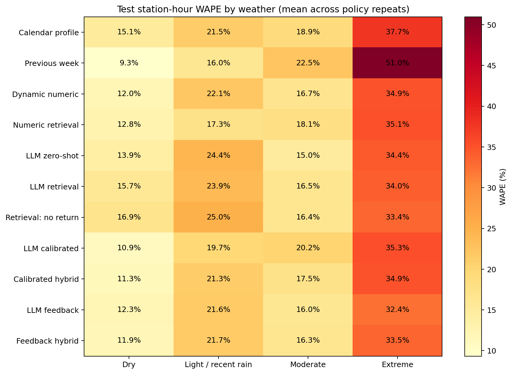
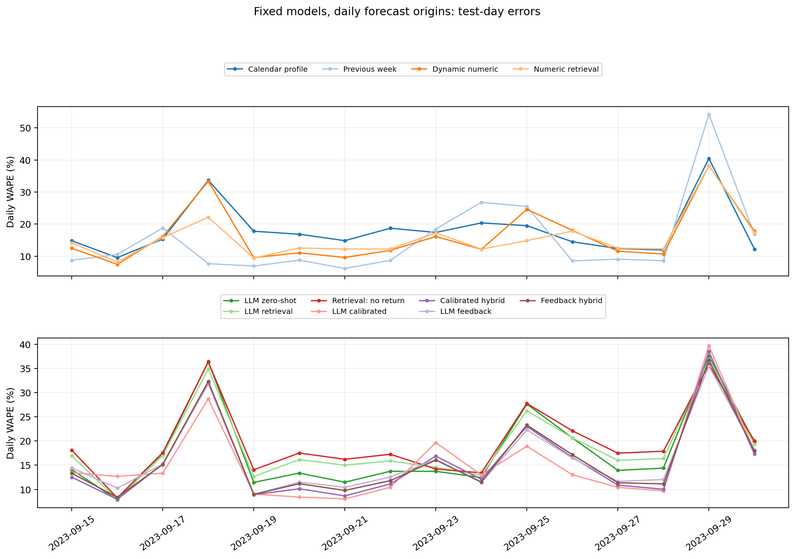
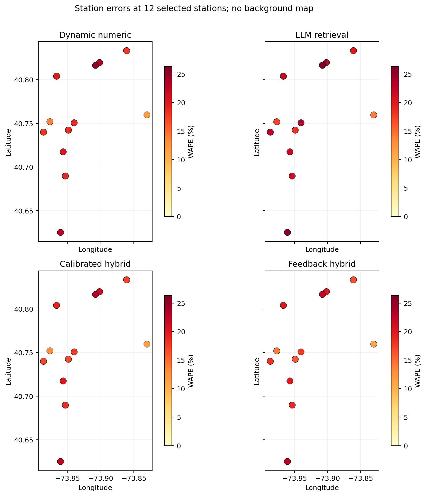
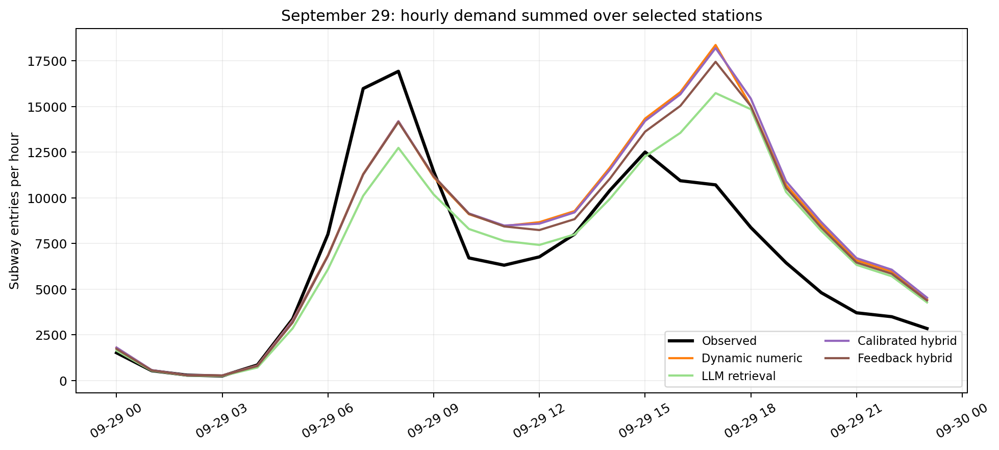
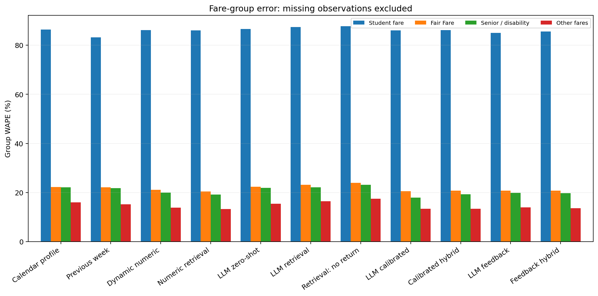

# 第二轮实验结果

本轮整体表现最好的是 `weekly`（WAPE 13.18%）。统计校准后的 LLM 普通天气误差为 13.55%，低于 numeric 的 14.89%，但仍高于 weekly 的 11.52%。极端时段 weekly 为 50.97%，LLM feedback 为 32.43%，numeric 为 34.90%。没有一个方法在所有天气都最好。

本轮使用 12 个站点、16 个测试日期，测试窗口为 2023-09-15 至 2023-09-30。测试结果的事后排序中整体误差最低的 LLM 方法为 `llm_calibrated`，比动态数值模型低 1.27 个百分点。若 LLM 只优于 numeric 而未优于 weekly，不能称为优于全部非 LLM 基线。

这是旧数据上的重新划分，采用固定模型、逐日原点回测：每天产生新预测，但模型不每天重训。它不是项目级从未看过的新盲测；不能据此宣称新模型已在其他月份验证。事后最低误差只是测试后排序，不是测试前选定的赢家，也没有据此重新调参。

## 预测口径

每天午夜预测当天未来 24 小时，目标日真实客流不能进入提示或检索；前一个已完成测试日的真实客流允许成为次日已知历史。因此它不是在 9 月 15 日一次预测后续全部 16 天。当天实测天气作为已知条件，故这是给定天气的历史检验，不是获得真实天气预报后的部署效果。近期客流可及时取得也是回测假设。所有方法仅在共同测试站点小时比较。第二个策略重复使用 9 月 14 日完整一天热启动延期队列，但热启动日不参与最终测试评分；feedback / validation 指标保持冻结。

WAPE 为绝对误差之和除以真实客流之和，越低越好。LLM 指标对两个策略生成重复分别评分再平均，不是先平均预测再评分；重复不是独立天气事件。

## 主要误差

| 方法 | 所有测试小时 | 普通天气 | 干天气 | 小雨/近期雨 | 中雨 | 极端雨 |
|---|---:|---:|---:|---:|---:|---:|
| profile | 17.85% | 16.97% | 15.11% | 21.49% | 18.91% | 37.68% |
| weekly | 13.18% | 11.52% | 9.33% | 16.05% | 22.50% | 50.97% |
| numeric | 15.73% | 14.89% | 11.96% | 22.09% | 16.73% | 34.90% |
| retrieval_numeric | 15.06% | 14.18% | 12.81% | 17.27% | 18.09% | 35.13% |
| llm_zero | 17.59% | 16.85% | 13.91% | 24.39% | 15.00% | 34.35% |
| llm_retrieval | 18.68% | 18.00% | 15.72% | 23.87% | 16.53% | 33.97% |
| llm_retrieval_no_return | 19.74% | 19.14% | 16.89% | 25.04% | 16.39% | 33.37% |
| llm_calibrated | 14.47% | 13.55% | 10.89% | 19.66% | 20.25% | 35.29% |
| llm_hybrid | 15.09% | 14.22% | 11.31% | 21.25% | 17.46% | 34.94% |
| llm_feedback | 15.68% | 14.95% | 12.26% | 21.58% | 16.03% | 32.43% |
| llm_feedback_hybrid | 15.49% | 14.70% | 11.86% | 21.67% | 16.35% | 33.50% |

纯 LLM 策略仍在减少需求：

整体总量偏差 numeric 为 -9.37%，zero-shot 为 -13.01%，retrieval 为 -14.14%，统计校准后为 -3.76%。负值表示少预测。检索没有自动修复少预测；本轮明显改善来自校准后的量级恢复，不能把这部分全归功于 LLM 自发理解。

上一周同小时基线在普通天气 WAPE 为 11.52%，但 extreme 为 50.97%。它的整体最好不能证明它擅长极端天气；少数极端小时和多数普通小时需要分开判断。

本轮换了站点及时间划分，不能把首轮和第二轮误差直接作同条件升级幅度。

## 测试前的验证期选择

下面单独读取冻结的 development 指标，按验证期整体 WAPE 排序；不使用测试误差选择。若数值相同，列出的只是排序中第一个，不应宣称有优势。

| 范围 | 验证期最低模型 | 验证 WAPE | 该模型测试 WAPE |
|---|---|---:|---:|
| 全部方法 | llm_feedback_hybrid | 8.69% | 15.49% |
| LLM 方法 | llm_feedback_hybrid | 8.69% | 15.49% |

普通天气仅排除 extreme 小时，并保留同一天内的其他小时；不是把所有暴雨日整天删除。light 也包括本小时已停雨但过去六小时仍有雨的情况。

`llm_retrieval_no_return` 免费重放相同 retrieval 策略，唯一变化是推迟需求返回率从 0.6 改为 0；它用于检查延迟回流这一模型假设，不代表真实乘客取消率为 100%，也没有重新生成 LLM 策略。

## 与数值基线的配对检查

按日将所有站点误差相加，再配对重采样 2,000 次。差值 = LLM WAPE − numeric WAPE，负值表示 LLM 更好。下表为普通天气；全部天气结果在 CSV 中。

| 方法 | 误差差值（百分点） | 95% 重采样区间（百分点） |
|---|---:|---:|
| llm_zero | +1.96 | [+1.33, +2.46] |
| llm_retrieval | +3.11 | [+2.10, +3.96] |
| llm_retrieval_no_return | +4.25 | [+3.06, +5.22] |
| llm_calibrated | -1.34 | [-2.56, -0.01] |
| llm_hybrid | -0.67 | [-0.92, -0.36] |
| llm_feedback | +0.05 | [-0.59, +0.69] |
| llm_feedback_hybrid | -0.19 | [-0.53, +0.12] |

这里的区间只表达这些日期内误差波动。相邻日期可能相关；一天的多个站点、两个策略重复并不会增加独立事件数量。区间也未校正多个方法比较，不能据此宣称城市泛化或因果显著。

## 校准选择

数值基线 Ridge alpha = 10.0，只根据 feedback 选择。LLM 校准混合权重 = 0.25；feedback 混合权重 = 0.5，两者由 Sep12–14 validation 选择，未使用测试误差挑权重。0 表示完全采用 numeric，1 表示完全采用相应 LLM 输出。

若混合权重为 0，混合方法与 numeric 一致；这说明校准窗口未支持引入该 LLM 输出，不能把保留 numeric 的结果算成 LLM 的改善。数值校准的效果与真实 LLM feedback 的效果要分别比较。

## 群体与解释边界

学生、Fair Fare、老人/残障、其他票种都是票种代理标签，不是实测人格和完整人口属性。老人和残障仍无法分开。群体评分排除该组真实值缺失的行；站点总评分使用真实总量。预测误差低不证明“取消、换方式、延迟”的真实比例，也不能将假设行动图当作调查事实。

反馈 critic 输出 192 格活动倍率，而纯统计校准只拟合 12 个站点倍率，两者校准容量不同。反馈的区别不能单独归因于 LLM 推理，后续应加入同容量的纯统计对照。

检索输入的 `group_block_observed_over_numeric` 在群体有缺失时，分子只包含有观测小时，分母仍包括整个时间块，可能低估相似日比率。测试期两个 seed 共用的检索实例按唯一曝光计：学生部分缺失 796/2304（34.5%），Fair Fare 611/2304（26.5%），老人/残障 908/2304（39.4%），general 仅 1 个；相对于匹配观测小时口径，比率中位偏低分别为 4.2%、9.0%、8.2%。这是输入比率偏差，不能当作预测误差贡献或缺失真实值已知为零。本轮保留冻结模型与原预测，不据测试事后改提示；下一轮改为匹配小时分子/分母。

## API 与复现

第二轮本地日志记录 370 次 API 调用，输入 1,148,543、输出 706,184，共 1,854,727 tokens。只统计 API 已返回 usage 的用量；另有 16 次记录标记为用量未知，不能假设这些调用免费。冻结设计的预算为 2,000,000 tokens；最后因未知失败预留触发预算保护，操作上限扩至 2,100,000，仅完成原定修复，没有新增模型。此统计包括日志中的试跑与重试，不打印提示内容或密钥，不包含首轮另存的日志。

日志中有 22 次真实 API 格式修复调用，其中首次发现越界活动倍率 m=1.63。程序保留原始调用和用量，再向真实 API 请求符合约束的修复；没有手工裁剪或虚构策略。

预算保守记账为 2,029,097 tokens，包含无 usage 失败调用的预留额度；这个数字用于限制预算，不是已知实际计费量。

从本目录运行 `python v2_analyze.py` 可免费重做分析，读取保存预测而不调用 API。`v2_results/development_metrics.csv` 另存 feedback / validation，当前图表及结果表只报告 test。主流程另从源数据重建，并以 `test --offline` 重放：82,152 行预测、4,564 个共同站点小时、18 个模型/样本组合，预测最大逐数差为 0.0，校准选择保持一致，没有新增 API 请求；见 `v2_results/reproducibility.json`。

数据表：`metrics_summary.csv` 保留每次重复和平均指标；`station_metrics.csv`、`group_metrics.csv`、`daily_metrics.csv`、`paired_bootstrap.csv` 保存细分结果。

## 下一步优先做什么

1. 修复群体检索比率的缺失对齐：分子和分母使用同一批有观测小时，并在新实验中重新冻结提示。
2. 加入和 critic 相同 192 格容量的纯统计校准，对比同信息、同容量的方法，判断收益究竟来自校准还是 LLM。
3. 补充学校日历、线路服务/停运及新的月份，先冻结方法再独立验证。暂不继续无条件增加 agent 或 API 次数。

## 图表

