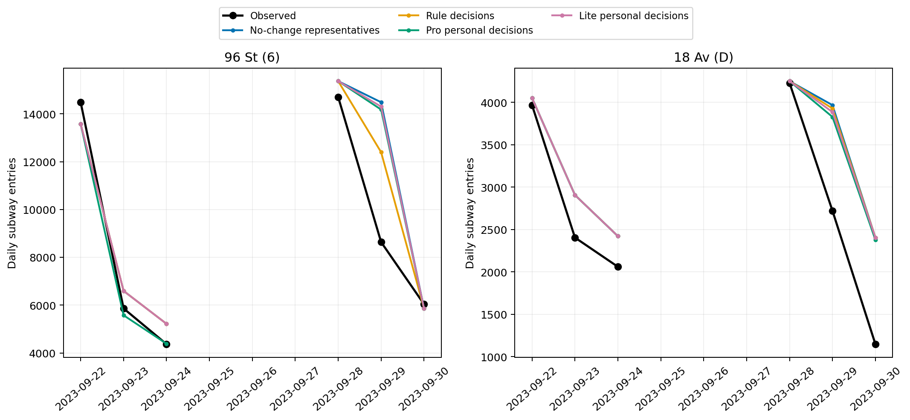
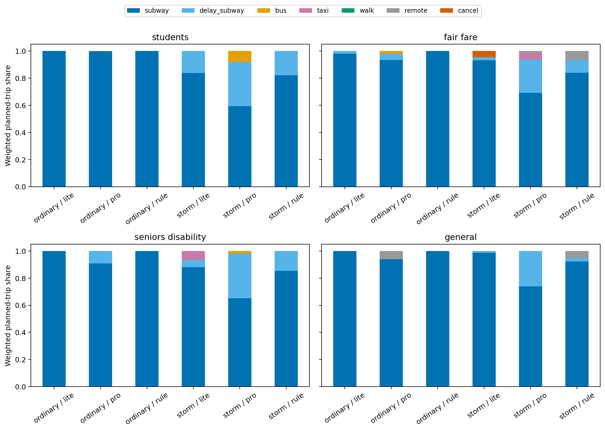
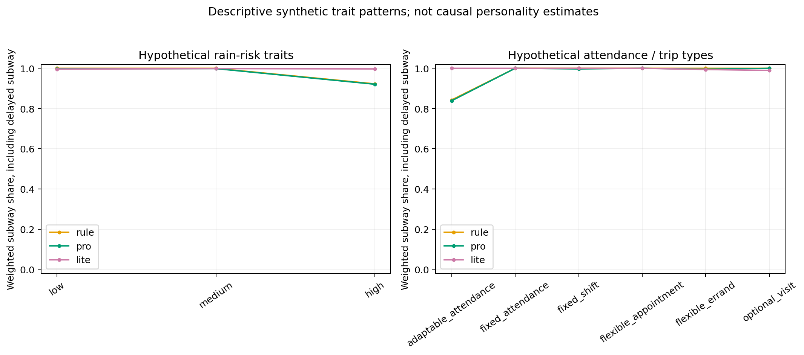
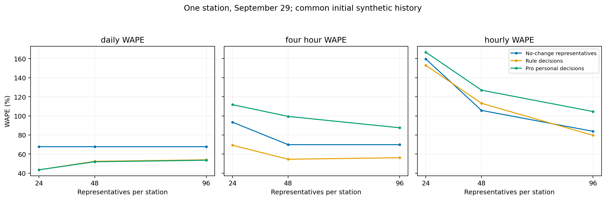
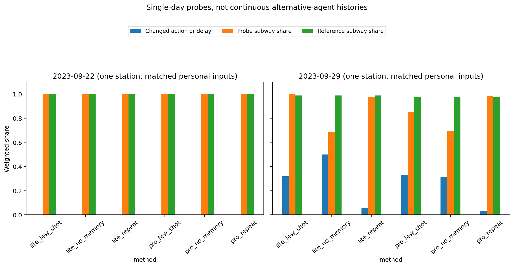

# V3 个人选择实验结果

本轮站点日总误差最低的是 `rule`，WAPE 14.90%。主实验为 2 站、6 天、每站 24 个代表人物。

每个 LLM 请求只替一个人选择一次出行方式，Python 按权重加总到站客流。它看不到站点总客流、权重或整体倍率。Rule、Pro、Lite 使用同一批人物、计划、环境和行动约束；规则仅在 Sep8–10 feedback 选择参数，测试后不调参。

## 主要误差

| 方法 | 站点日总 WAPE | 4 小时 WAPE | 逐小时 WAPE | 日总偏差 |
|---|---:|---:|---:|---:|
| planned_profile | 17.79% | 18.70% | 20.37% | +14.72% |
| no_change | 17.91% | 39.78% | 108.68% | +14.84% |
| rule | 14.90% | 36.90% | 108.60% | +11.83% |
| pro | 15.43% | 38.64% | 111.16% | +11.55% |
| lite | 17.54% | 39.53% | 110.47% | +14.47% |

按窗口看日总误差：

| 方法 | 普通窗口 Sep22–24 | 暴雨窗口 Sep28–30 |
|---|---:|---:|
| no_change | 10.37% | 24.58% |
| rule | 10.37% | 18.90% |
| pro | 6.51% | 23.32% |
| lite | 10.37% | 23.88% |

这两个窗口各含三天，不等于逐小时的普通/极端天气分类。Pro 在普通窗口较好，但暴雨窗口未超过规则；不能只选一种窗口宣称整体优势。

`planned_profile` 是小时计划量；`no_change` 让所有代表按计划乘地铁。完整网格的总量相同，但一个代表只在一个时刻出现，小时误差会受离散影响，不能直接算作决策错误。日总优先检查计划规模。

指标和日图只加总有真实观测的共同小时，缺失不按零处理。群体指标也使用该组可观测小时。

站点 66 / 2023-09-29 只有 23/24 小时观测，因此是部分日汇总；见 coverage.csv。

| 日总配对比较 | WAPE 差（百分点） | 按日重采样区间 |
|---|---:|---:|
| pro − no_change | -2.48 | [-6.32, -0.44] |
| lite − no_change | -0.37 | [-1.19, +0.00] |
| pro − rule | +0.54 | [-5.13, +6.68] |
| lite − rule | +2.64 | [+0.00, +8.49] |

## 个人动作、记忆与代表人数

人物权重代表合成出行机会，不是调查人口数。人格、目的、费用和记忆都是假设；票种只作群体标签，老人/残障不能从真实数据拆开。图中的动作/人格差异和 reason 不能证明真实乘客行为或人格因果效应。

subway 与 delay_subway 都是地铁选择；延期只在到站时计一次。窗口外到站和缺失观测小时的质量另列在 mass_audit.csv。

配对检查只取一站的 Sep22、Sep29，保留同个人主选择前状态，比较无记忆、few-shot、重复请求。它们不是连续六天的替代学习轨迹；记忆效应须与重复采样的变化一起看。

| 检查 | 日期 | 选择改变（加权） | 地铁份额变化（百分点） |
|---|---|---:|---:|
| lite_few_shot | 2023-09-22 | 0.0% | +0.0 |
| lite_few_shot | 2023-09-29 | 31.9% | +1.3 |
| lite_no_memory | 2023-09-22 | 0.0% | +0.0 |
| lite_no_memory | 2023-09-29 | 49.9% | -29.8 |
| lite_repeat | 2023-09-22 | 0.0% | +0.0 |
| lite_repeat | 2023-09-29 | 5.8% | -1.0 |
| pro_few_shot | 2023-09-22 | 0.0% | +0.0 |
| pro_few_shot | 2023-09-29 | 32.9% | -12.9 |
| pro_no_memory | 2023-09-22 | 0.0% | +0.0 |
| pro_no_memory | 2023-09-29 | 31.4% | -28.4 |
| pro_repeat | 2023-09-22 | 0.0% | +0.0 |
| pro_repeat | 2023-09-29 | 3.4% | +0.3 |

Sep29 去掉记忆后，pro 地铁份额下降 28.4 个百分点，选择变化 31.4%（重复请求变化 3.4%）；lite 地铁份额下降 29.8 个百分点，选择变化 49.9%（重复请求变化 5.8%）。这说明本次输入对记忆敏感，不等于真实乘客学习已验证。

24/48/96 人数探针是一站 Sep29 的独立单日 episode，共用初始合成记忆，不是主三天窗口重跑。no_change 的小时误差可看离散程度；增加代表也会改变采样。结果见 resolution_metrics.csv 和下图。

no_change 的逐小时误差从 24 人的 159.68% 降到 96 人的 83.83%，而日总误差不变。Pro 的日总误差却从 43.51% 到 53.53%；更多代表主要减轻时间离散，不能保证提高日总预测。

## 首次响应与最终执行

| 模型 | 首次完成响应数 | 首次结构合法 | 首次行动及延期合法 | 主测试最终执行合法 |
|---|---:|---:|---:|---:|
| pro | 622 | 617/622 | 617/622 | 264/264 |
| lite | 531 | 531/531 | 531/531 | 264/264 |

首次指日志 repair_attempt=0 且 status=completed 的原始返回，按该请求 available_actions 和 delay 上限检查；未完成响应、网络失败另计。最终执行是修复/重试后的主测试选择，两种分母不同。最终都合法不意味着原模型首次都合法。日志汇总包含 pilot 等额外请求。

## 用量与可信度

| 模型 | 调用 | 已报告 tokens | 未知失败 | 不完整返回 | 重试轮次 | 格式修复 | 保守记账 |
|---|---:|---:|---:|---:|---:|---:|---:|
| lite | 533 | 336,848 | 1 | 0 | 1 | 0 | 338,212 |
| pro | 650 | 401,338 | 16 | 0 | 20 | 5 | 423,073 |

到站质量守恒的最大差为 1.5e-11，属于浮点舍入；缺失源观测小时的到站质量单独记录，不参加评分。

冻结预算记录：{"pro": 530000, "lite": 460000}。未知失败按预留记账，不能视为免费；重试轮次既可能是网络重试，也可能格式修复。日志包含试跑、feedback、测试和额外探针，不是只有主测试。

这是实测天气条件下的旧数据回测，不是天气预报部署或新盲测。普通、暴雨各三天独立重置记忆；日期少且共享天气，按日 bootstrap 不代表独立极端事件置信保证。V1/V2 与本轮任务和指标不同，不能直接作升级前后比较。

## 人物理由示例

- pro / fair_fare / flexible_errand / dry → subway，延期 0 分钟：No verified disruption; subway is affordable, familiar, and fits my errand schedule.

- pro / general / flexible_errand / dry → subway，延期 0 分钟：I usually take the subway, it fits my budget, and no disruption is verified.

- lite / fair_fare / flexible_errand / dry → subway，延期 0 分钟：Dry mild afternoon, subway fits my budget and usual errand travel habit.

- lite / general / flexible_errand / dry → subway，延期 0 分钟：Dry weather, budget fits subway, and my past rides completed without disruption.

示例按模型、群体、天气取排序第一条，未挑精彩案例；完整原文见 reason_examples.csv。

另有一条 Lite 理由提及未提供的 forecast，而输入明确没有未来天气预报。菜单与延期约束合法不保证理由信息忠实；这个实例需要审阅，不能当成真实预报或全体语义准确率。

从 V3 执行 `python analyze.py` 免费重做分析。feedback_metrics.csv 单独保留，不混入测试；metrics_summary.csv、action_shares.csv、trait_actions.csv、paired_bootstrap.csv、response_quality.csv 保存详细结果。

## 图表

