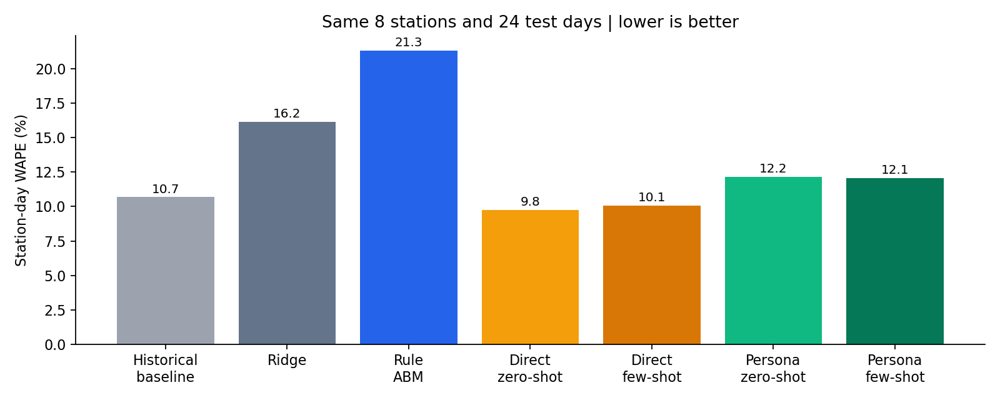
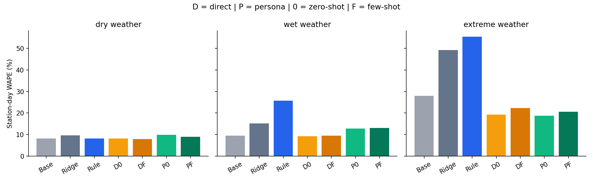
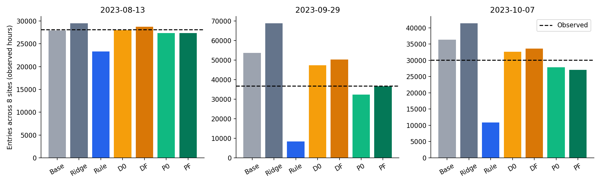
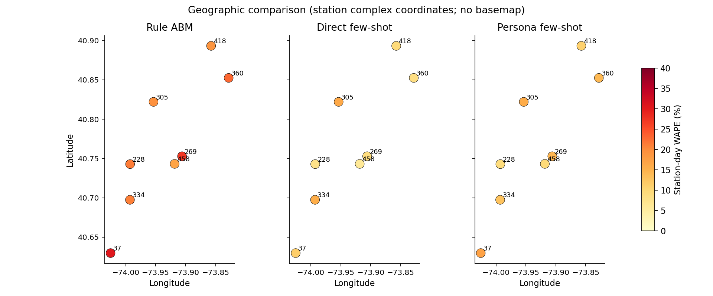
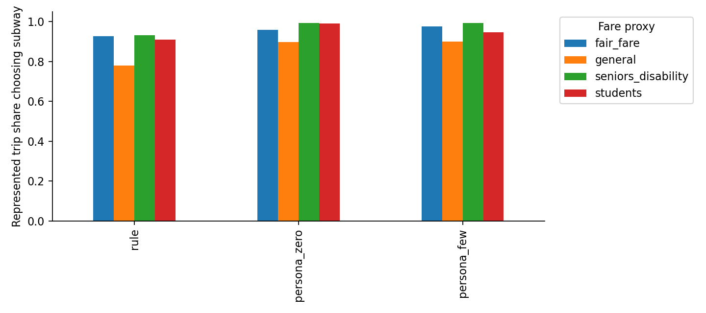
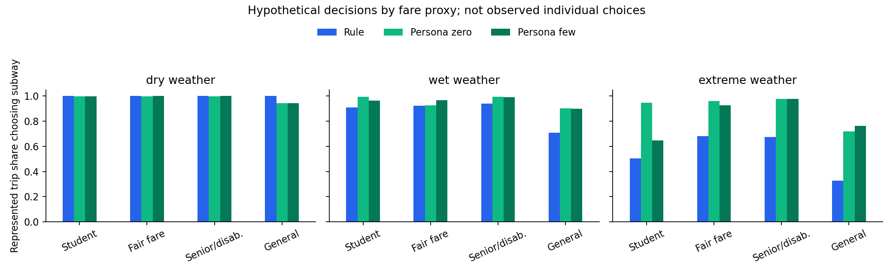
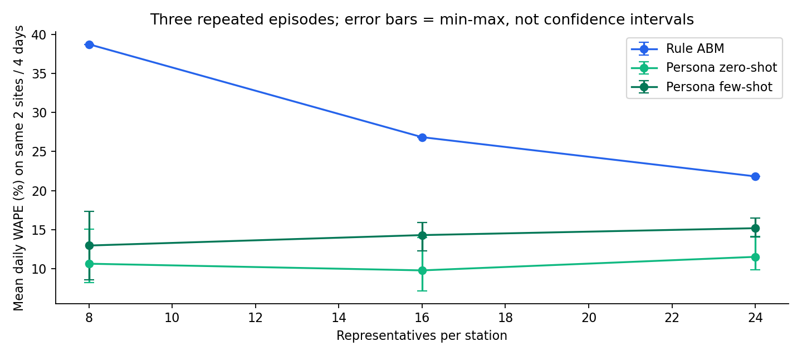

# V4 结果

本轮是 8 站、24 天的天气已知回顾性测试；实际评分 4,597 个站点小时。日总误差最低：直接预测 zero-shot。

WAPE = 各站预测与实际的绝对差之和 / 实际客流之和，越低越好。它不是准确率；偏差为负表示整体少预测了。

| 方法 | 日总 WAPE | 四小时 WAPE | 小时 WAPE | 偏差 |
| --- | ---: | ---: | ---: | ---: |
| 历史客流基线 | 10.68% | 12.21% | 14.26% | +4.65% |
| Ridge 数值模型 | 16.16% | 17.59% | 19.29% | +14.26% |
| 规则 ABM | 21.32% | 25.08% | 26.66% | -16.79% |
| 直接预测 zero-shot | 9.76% | 11.64% | 13.68% | +2.47% |
| 直接预测 few-shot | 10.09% | 11.77% | 13.84% | +3.10% |
| 角色决策 zero-shot | 12.17% | 20.51% | 24.02% | -5.25% |
| 角色决策 few-shot | 12.08% | 19.01% | 22.02% | -5.00% |

表现最好的 LLM 是 直接预测 zero-shot，比规则 ABM 的日总误差低 11.56 个百分点。
加入示范后：直接路线误差变化 +0.33 个百分点；角色路线 -0.09 个百分点。负数才是改善。

原始结果是主要比较；验证期总量校正结果另见 res/calibrated_metrics.csv，不能在测试后选有利的校正方法。

## 普通和极端天气

| 方法 | 干燥日 | 非极端雨天 | 强降雨日 |
| --- | ---: | ---: | ---: |
| 历史客流基线 | 8.11% | 9.45% | 28.00% |
| Ridge 数值模型 | 9.66% | 15.13% | 49.25% |
| 规则 ABM | 8.11% | 25.76% | 55.38% |
| 直接预测 zero-shot | 8.18% | 9.22% | 19.29% |
| 直接预测 few-shot | 7.91% | 9.51% | 22.35% |
| 角色决策 zero-shot | 9.88% | 12.82% | 18.67% |
| 角色决策 few-shot | 8.95% | 13.05% | 20.56% |

## 额外对照

只比较同样的两个站、四天，不能直接与上面的八站结果比较。增加人数与增加背景分开做；人数增加也扩大人物类型覆盖，这是配置敏感性，不是纯数量的因果效果。

首轮重新采样时，角色 zero-shot 的误差从 8.18% 变成 15.08%，因此补足每个原配置三次重复；不改变主实验或提示参数。下面是三次平均 ± 标准差（百分点），不是置信区间。

| 配置 | 规则 ABM | 直接 zero | 直接 few | 角色 zero | 角色 few |
| --- | ---: | ---: | ---: | ---: | ---: |
| 8 人控制组 | 38.74% ± 0.00 | 15.50% ± 1.46 | 16.23% ± 1.28 | 10.62% ± 3.86 | 12.95% ± 4.40 |
| 16 人 | 26.84% ± 0.00 | 15.50% ± 1.46 | 16.23% ± 1.28 | 9.77% ± 3.68 | 14.29% ± 1.85 |
| 24 人 | 21.81% ± 0.00 | 15.50% ± 1.46 | 16.23% ± 1.28 | 11.50% ± 2.31 | 15.17% ± 1.21 |
| 8 人 + 人口/路网背景 | 38.74% ± 0.00 | 14.56% ± 1.36 | 16.71% ± 1.09 | 10.30% ± 2.39 | 12.37% ± 2.75 |

把同一配置的三次预测按小时等权平均，再评分，属于事后免费诊断，不是重新挑一次表现最好的运行。8 人控制组的平均预测误差为：直接预测 zero-shot 15.35%；直接预测 few-shot 16.12%；角色决策 zero-shot 8.18%；角色决策 few-shot 12.37%。这些数值仍只对应两个站、四天。其他配置见 probe_ensemble_metrics.csv。

重复实验中，角色路线的波动大于直接路线。16 人的角色 zero-shot 均值略好，24 人没有继续改善；人口/路网背景的改善较小，均小于相应的采样波动。暂时没有稳定证据支持“更多人物或更多背景就更准”。角色 few-shot 的示范来自合成规则，也没有带来一致的改善。

强降雨只有 Aug13、Sep29、Oct7 三天，不能把 24 个站点日当成 24 次独立暴雨。三个事件单独看 event_metrics.csv 和下图。按日期重采样区间见 paired_bootstrap.csv。

## 规则为什么落后

验证期选出的降雨系数为 4，主测试中规则总体少预测了约 16.8%。事后免费重放所有事先列出的系数，检查这种结果是否依赖系数。下面不用于重新挑选主模型。

| 降雨系数 | 验证期日总 WAPE | 测试期日总 WAPE | 是否原选值 |
| --- | ---: | ---: | --- |
| 0 | 7.78% | 10.71% | 否 |
| 0.5 | 7.78% | 9.88% | 否 |
| 1 | 7.78% | 11.44% | 否 |
| 2 | 7.49% | 15.94% | 否 |
| 4 | 6.93% | 21.32% | 是 |

这份表检验规则参数能否从少量普通雨天迁移到强降雨；不能把 LLM 胜过当前规则，写成胜过所有规则模型。
直接 zero-shot 相对历史基线的日总误差改善约 0.92 个百分点，但按日期重采样的区间包含零；目前不能确定这个小幅优势在更多日期上仍成立。角色路线的强降雨日总误差较低，但小时误差仍高，全天总数接近不代表各时段准。

## 如何解释

- 角色与规则使用相同画像、机会量和执行器；画像不是实测个人，reason 不是行为真值。学生、低收入优惠、老人/残障都是票种代理；老人和残障在模拟中区分，在真实评分中仍只能合并。
- 身份、目的和出行约束随人物设定同时变化，不能把选择差异归因于单个人口或性格标签。群体天气下的行动份额在 group_weather_actions.csv，具体原文在 reason_examples.csv。
- 直接预测可增加需求，当前角色/规则只调整原有地铁出行机会，不能凭空产生新增客流。这是两类架构的能力差异，不应只归因于 LLM 本身。
- 同时报告小时指标；角色策略按四小时段变化，直接预测也只输出四小时段，段内分配沿用历史小时形状。
- 只评分有观测的小时，部分日不是完整日；跨午夜的延期另记账，不把它重复加到当天。
- 新人口/当前网络维度只进入回顾性子集对照。它们不能用于声称严格时间可用的 2023 预测改进；Sep29 服务归档只有事件日且含估计值，只作背景资料，不能推断关闭。

## API 用量

共 5,671 次实际调用，已报告 5,965,361 token，含未知失败的保守记账 5,981,919。均为 Lite，含试跑、验证和额外探针；明细见 api_usage.csv。

## 复现检查

7 项单元检查通过；14 组预测文件都能用已有真实缓存免费重放，数值完全相同。52,308 条个人行动记录通过菜单、预算、必须到场与延期上限检查；这证明实现符合设定，不能证明行为设定符合真实乘客。逐项记录见 res/manifest.json。

从 V4 执行 `python analyze.py` 可免费重做分析。全部真实提示及响应保留在 api_calls.jsonl.gz；不存在用规则或手填文本冒充 API 返回。

