# V5 结果：逐日预测，Normal / Extreme 分开做

这版已完成六种方法、三套数据切分、两次额外重复调用、Normal_B/Extreme 双向迁移，以及网页数据小样。结论是：**LLM 直接预测在两组正常天气上有竞争力；角色模型加入群体历史有时改善，但不能稳定处理极端天气，也没有解决学生客流跨学期增长。**

所有结果都是给定目标日实测天气的回顾性预测。没有向模型提供测试日客流，也没有测试后按分数换主模型参数。数据此前探索过，所以不是全新、从未看过的盲测。

## 1. 用了哪些数据

四站：Bronx 的 Pelham Bay Park、Brooklyn 的 77 St (R)、Manhattan 的 23 St (F/M)、Queens 的 Northern Blvd。时间统一到日；不足 24 小时的站日不评分。

| 数据集 | 训练 | 验证 | 测试 |
|---|---|---|---|
| Normal_A | 7/5–7/26 中符合条件的 16 天 | 8/1–3，3 天 | 8/4–10，连续 7 天 |
| Normal_B | 8/17–9/2 中符合条件的 16 天 | 9/3–9，7 天 | 9/12–17、9/19–22，10 天 |
| Extreme | 7/2、7/18、7/29 的事件窗口，共 14 天 | 8/13 的窗口，5 天 | 9/29、10/7 的窗口，共 10 天 |

Normal 允许小雨：日雨量 <10 mm，并剔除 Extreme 整个窗口。Extreme 筛选为日雨量 ≥25 mm 或最大小时雨量 ≥10 mm，每个事件带前后两天；7/2 受数据起点限制只有前一天。**这六次不是同等级大暴雨**：事件日雨量分别约 11.94、35.31、16.26、16.00、207.01、47.75 mm。9/29 明显比训练事件更强。

三套数据日期不重叠，训练、验证和测试按时间先后，参数独立。每一天、天气和角色在 [dates.csv](res/dates.csv)，站日真值在 [panel.csv](res/panel.csv)。

| 测试集 | 有效站日数 | 平均入站量/站日 | 入站量最小–最大 | 日雨量范围 mm |
|---|---|---|---|---|
| Extreme | 39 | 5,738 | 1,812–20,063 | 0.00–207.01 |
| Normal_A | 27 | 6,303 | 1,734–18,781 | 0.00–6.60 |
| Normal_B | 39 | 7,554 | 1,717–20,543 | 0.00–0.51 |

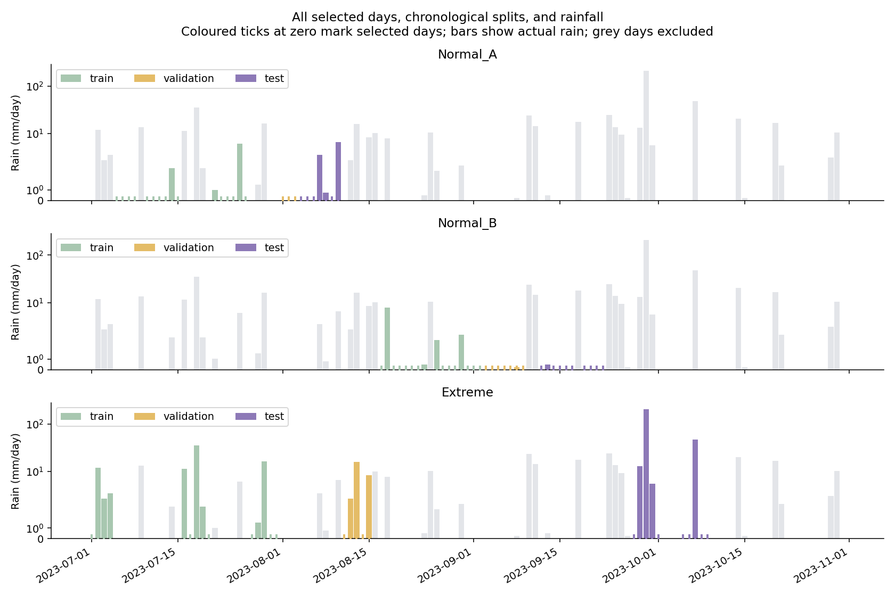

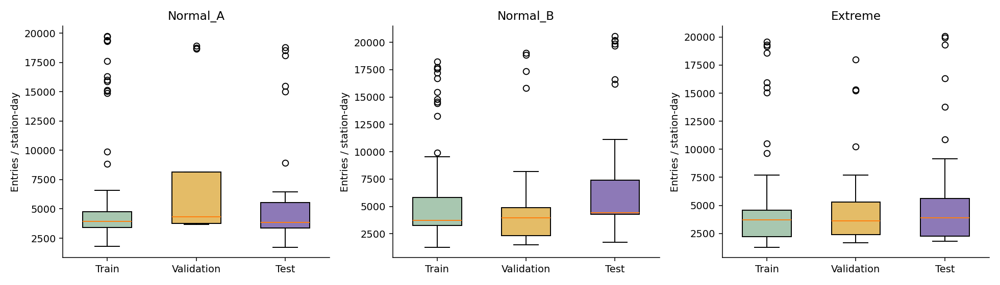

Normal_A 是相对稳定的暑假窗口。Normal_B 跨过开学：学生票种训练期约 29 次/站日，测试期约 301 次/站日。因此它额外检验了跨期变化，不能把差异全部归因于天气。开学日期参考 [NYC 官方 2023 年通知](https://www.schools.nyc.gov/about-us/messages-for-families/past-messages-2023)。Normal_A 验证只有周二到周四三个干天，没有周末，参数选择的可靠性有限；Normal_B 验证覆盖整周，但也几乎无雨。

## 2. 各方法效果

WAPE 是绝对误差总和除以真实客流总和，越低越好。这里不把 `1-WAPE` 包装成“分类准确率”。另有 MAE、RMSE、偏差、±10%/±20% 命中比例，见 [metrics.csv](res/metrics.csv)。

| 方法 | Normal_A | Normal_B | Extreme 全窗口 | Extreme 仅事件当天 |
|---|---|---|---|---|
| 星期均值 | 4.99% | 14.71% | 11.23% | 20.82% |
| Ridge | 5.55% | 15.91% | 26.50% | 12.26% |
| 规则 ABM | 15.84% | 21.73% | 26.96% | 19.57% |
| LLM 直接 few-shot | 4.29% | 13.17% | 16.06% | 34.63% |
| 角色无历史 | 18.24% | 14.94% | 31.28% | 47.32% |
| 角色有历史 | 12.58% | 11.39% | 21.49% | 49.09% |

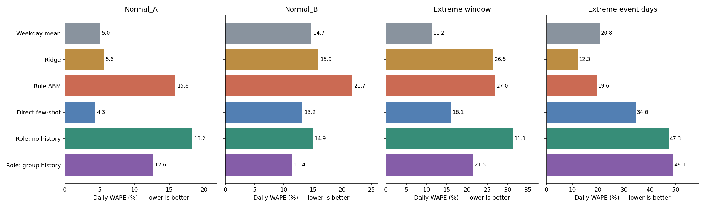

- 稳定的 Normal_A：直接 few-shot 与简单星期均值都较好，角色模型没有优势。
- 跨开学的 Normal_B：主调用的角色有历史最好，但重复调用会波动，不能只挑这一次的 11.39% 当作稳定水平。
- Extreme：整个窗口与暴雨当天的排序不同。Ridge 在两次事件当天误差较低，但前后对照日较差；星期均值全窗口较稳。主调用的 LLM 角色在事件当天明显低估客流，但重复调用的波动很大，不能只凭这一轮定论。

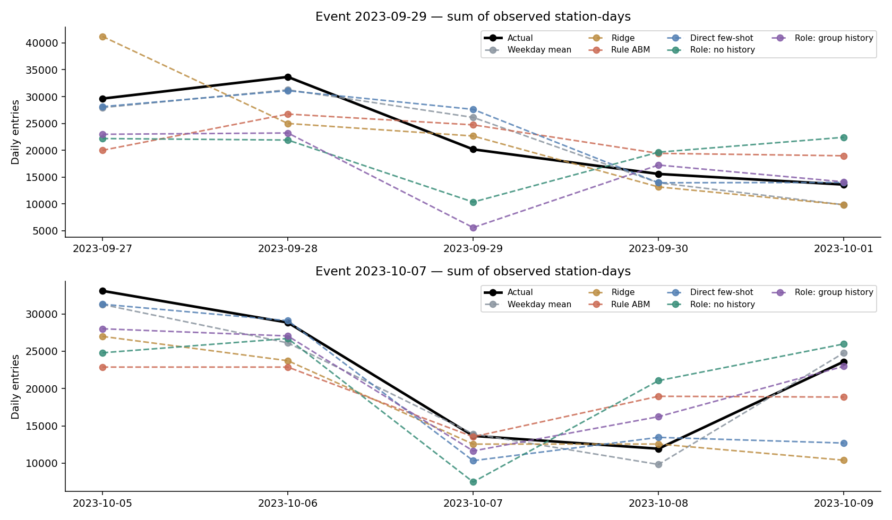

固定训练系数后，对三种 LLM 方法的测试输入再调用两次。以下为三次 WAPE 的平均值 ± 样本标准差（百分点），不是置信区间，也不包含重训或换数据的不确定性：

| 方法 | Normal_A | Normal_B | Extreme 全窗口 |
|---|---|---|---|
| LLM 直接 few-shot | 3.99 ± 0.29 | 12.81 ± 0.35 | 14.79 ± 1.15 |
| 角色无历史 | 15.98 ± 2.11 | 14.70 ± 0.69 | 27.88 ± 2.96 |
| 角色有历史 | 14.83 ± 1.98 | 12.32 ± 2.17 | 20.54 ± 1.16 |

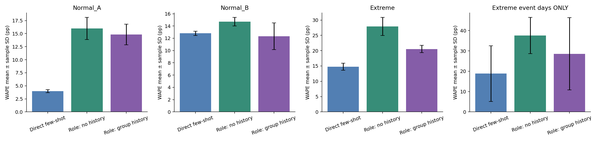

只看两个事件当天，三次误差的波动更大：直接 few-shot 为 **18.82% ± 13.70**，角色无历史为 **37.53% ± 8.92**，角色有历史为 **28.60% ± 17.77**。角色有历史的单次误差在 **17.50%–49.09%** 之间，既不能挑最好一次，也不能把主调用最差的一次当成稳定表现。具体见 [repeat_event_summary.csv](res/repeat_event_summary.csv)。

[ensemble_metrics.csv](res/ensemble_metrics.csv) 还提供三次预测等权平均的结果，仅作补充，不替换主实验，也没有挑最佳一次。

## 3. 角色模型究竟做了什么

每个票种层设三类人物：固定活动、灵活事务、自主休闲，共 12 类。画像和方式费用/时间是情景假设，不是调查得到的真实个人资料。每个角色输出当天“地铁、公交、出租车、步行、不出行”五个概率和一句简短理由。

ABM 的日客流是 `sum(训练拟合的固定有效规模 × 当天乘地铁概率)`。有效规模由各任务训练集的票种客流拟合，验证选择收缩强度；不是每种人物各占一半。测试日没有统一的历史计划客流输入。角色无历史不看历史数据，但它外面的 ABM 仍用训练集校准规模。

角色有历史看最多四条真实的**票种群体客流指数**，不是个人选择标签。直接 few-shot 则看最多八条真实站日客流示例，直接输出日客流。Ridge 是独立对照，不藏在任何 LLM 或 ABM 里面。

例如 9/29，同为学生：固定活动角色给出的乘地铁概率是 0.80，理由是“预算排除了出租车，雨天步行不便，仍乘地铁”；自主休闲角色给 0.15，理由是“暴雨下放弃可选活动”。这些是模型生成的决策说明，不是可验证的内部思考过程或真实人的证言。原文见 [reason_examples.csv](res/reason_examples.csv)。

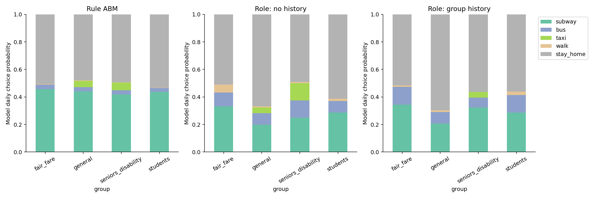

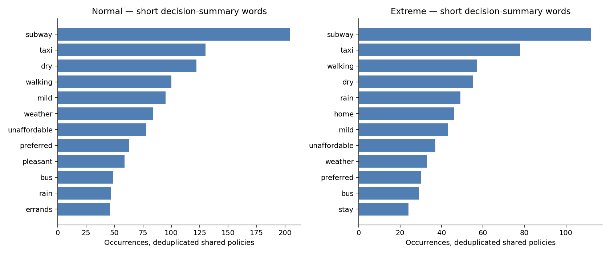

**学生组的失败有结构性原因。** Normal_B 角色有历史的学生误差约 86.4%。它从暑假数据拟合出的四站有效学生规模合计仅约 292；即使所有学生角色概率改成 100% 乘地铁，也至少留下约 80.1% 的学生客流误差。这个问题在人数/活动规模设定，不可能只靠换一句 prompt 解决。见 [capacity_diagnostic.csv](res/capacity_diagnostic.csv)。

因此，拟合权重只能当作预测模型系数，不能当作真实人口比例；整体误差较好也不能证明每个群体都可靠。票种也不等于完整社会群体：使用普通票的学生等仍在 general 中。老人/残障仍按原始合并票种评分，合成人物的需求可以不同，但没有真实分开标签可检验。

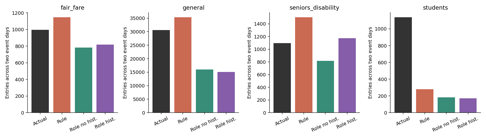

额外做了一个不用于调参的天气诊断：固定星期五、学期、人物、历史示例、温度和风，只改雨量 0/10/50/200 mm。它说明模型如何响应天气，不证明真实人的因果反应。

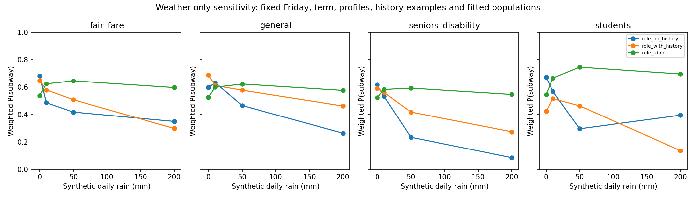

## 4. 迁移效果与运行成本

来源模型的训练和验证日期均早于目标测试日。保持来源任务的拟合参数和历史示例，在目标任务直接预测；不使用目标训练集重新拟合。正数表示误差增加，负数表示此次迁移反而更低。这同时包含天气、季节和校历变化，不能解释为纯天气效应。

| 迁移方向 | 方法 | 目标任务自身训练 WAPE | 迁移 WAPE | 变化 pp |
|---|---|---|---|---|
| Extreme → Normal_B | LLM 直接 few-shot | 13.17% | 11.19% | -1.98 |
| Extreme → Normal_B | Ridge | 15.91% | 19.20% | +3.29 |
| Extreme → Normal_B | 角色无历史 | 14.94% | 22.22% | +7.28 |
| Extreme → Normal_B | 角色有历史 | 11.39% | 18.86% | +7.47 |
| Extreme → Normal_B | 规则 ABM | 21.73% | 28.44% | +6.71 |
| Extreme → Normal_B | 星期均值 | 14.71% | 18.11% | +3.40 |
| Normal_B → Extreme | LLM 直接 few-shot | 16.06% | 15.75% | -0.30 |
| Normal_B → Extreme | Ridge | 26.50% | 14.77% | -11.73 |
| Normal_B → Extreme | 角色无历史 | 31.28% | 26.48% | -4.80 |
| Normal_B → Extreme | 角色有历史 | 21.49% | 19.62% | -1.86 |
| Normal_B → Extreme | 规则 ABM | 26.96% | 27.34% | +0.37 |
| Normal_B → Extreme | 星期均值 | 11.23% | 14.40% | +3.16 |

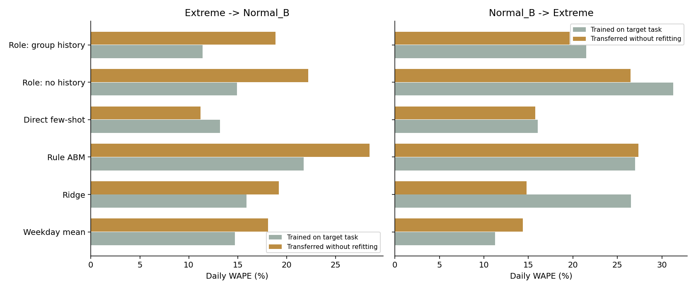

本轮实际发起 **4,168 次 API 请求，服务端报告 **2,784,663 token；含未知失败的保守计数 **2,788,506 token，低于 4,000,000 上限。全部使用 Lite，没有调用 Pro。

| 方法 | 主实验阶段实测耗时 | 全部 API 请求数 | 全部保守 token |
|---|---|---|---|
| 星期均值 | 0.04 秒 | 0 | 0 |
| Ridge | 0.14 秒 | 0 | 0 |
| 规则 ABM | 0.63 秒 | 0 | 0 |
| LLM 直接 few-shot | 58.76 秒 | 404 | 317,110 |
| 角色无历史 | 9.56 分钟 | 1,766 | 858,470 |
| 角色有历史 | 9.33 分钟 | 1,998 | 1,612,926 |

主实验阶段合计约 19.9 分钟，采用 6 并发；补充实验采用 12 并发。表中时间是主实验，token/调用数包含重复、迁移、天气诊断、两次试跑和重试，所以两列范围不同。API 服务耗时累计值、平均延迟另见 [api_cost.csv](res/api_cost.csv)；累计服务时间不等于并发运行的墙钟时间。

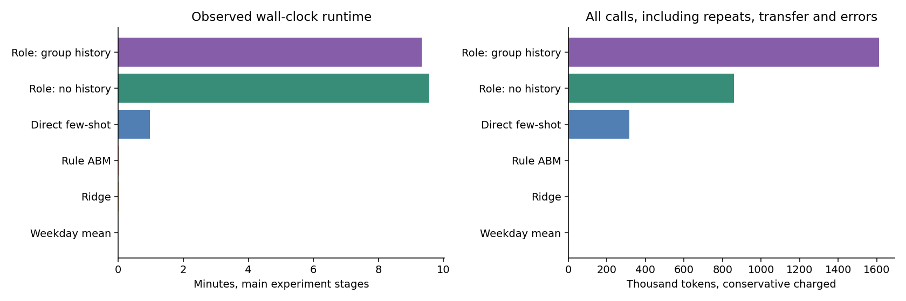

## 5. 网页组现在能拿到什么

[animation_demo](res/animation_demo/) 已有全部 445 个当前站点坐标、1,121 条简化有向连接，以及 80 个合成人物的小样。抽样得到 15 条地铁旅次，路线连接检查全部通过。`agents → trips → waypoints` 可以直接按秒插值移动图标。

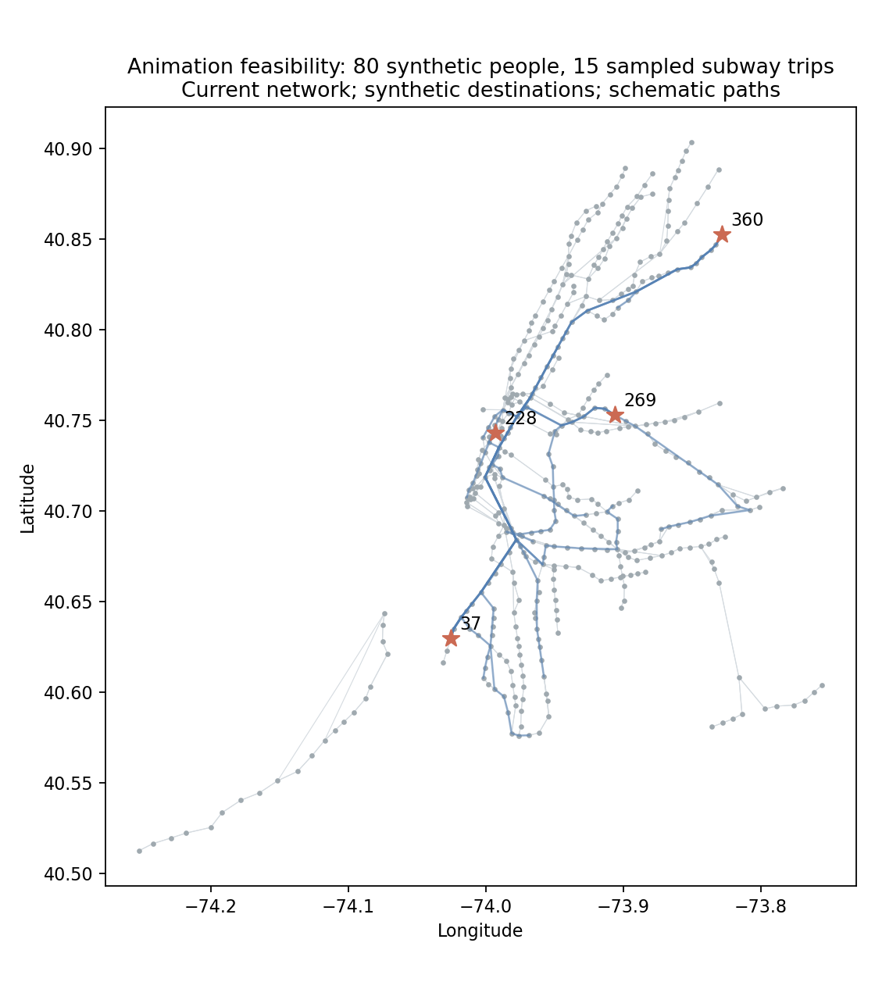

这只是接口可行性验证：目的地、出发时间和路线都是合成/假设，网络也是当前快照；没有声称还原 2023 年灾害当天的乘客轨迹。逐日客流本身不能识别真实 OD。字段与单位在 [README](README.md)。

后续最值得补的不是更多随机角色，而是：学期内外都覆盖的训练数据、独立的人群/活动规模依据、更贴近站点的天气与服务状态。然后再检查 LLM 是否改善决策。当前版本没有人与人互动、拥堵或列车运行反馈，是简化的角色行为 ABM；两次测试事件也不足以支持“普遍适用极端天气”的结论。

代码、原始 API 证据、逐日预测和图已保存；可重复运行的检查见 [audit.py](audit.py)，详细方法和文献依据见 [PROTOCOL](PROTOCOL.md)。
