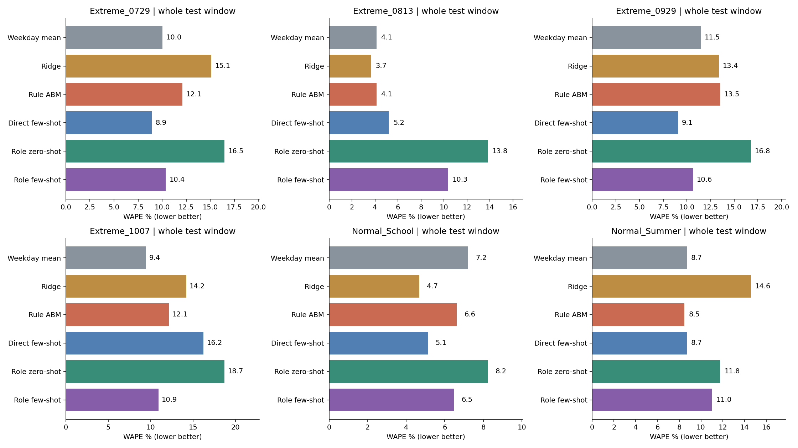

# 周周期与角色权重修复结果

周周期问题已修复，单个角色支配整个人群的问题已受到约束。但强降雨日仍有较大误差，规则 ABM 也会反应过强，不能把所有剩余问题归因于 LLM。

本次全部离线复用真实 API 回复，新增调用和 token 都是 0。没有修改 LLM 的原始概率或理由；没有重新划分数据，也没有按测试成绩挑选参数。这是看过测试结果后的修复检查，不是新的盲测。

## 改了什么

- 训练每个站点、票种的固定星期活跃度，分别表示周一至周日。预测为基础规模 × 星期活跃度 × 地铁选择概率。星期系数只用训练数据拟合，验证集选择平滑强度，测试时不读取真实客流。
- 每个票种内部三个代表角色占比限制为10%—60%。不同票种的总规模仍分别根据真实票种客流拟合。这个范围是防止拟合塌缩的技术假设，不是人口调查得到的真实比例。
- 规则 ABM 和两个角色 LLM 都使用这层周周期活动模型。星期均值、Ridge、直接 few-shot 不变。

具体实现和限制见 [REPAIR.md](REPAIR.md)。增加了星期参数，因此改善不能归功于 LLM 本身。固定画像及10%—60%的合理性仍需外部数据验证；此次没有用测试集寻找更有利的约束范围。

## 修复是否有效

合成测试设置工作日客流100、周六30、周日10，角色概率始终不变。用前三周训练，预测第四周，能还原该周期。另一个测试故意让一个角色解释全部训练变化，新拟合仍遵守占比约束。六项单元测试均通过。

真实数据中，修复前部分票种的一个角色占比达到100%；修复后全部有正规模的站点×票种×方法×任务均处于10%—60%范围。这是约束成功执行，不代表已识别真实人群构成。

10/7任务中，规则 ABM 的训练集周六/周日总量偏差原为+49.0%/+87.9%，现在均约−0.3%；验证集对应偏差从+44.1%/+65.1%降到+7.8%/+1.5%。这里的偏差是有方向的总量差，不是WAPE。

下表为四站汇总后的WAPE（绝对误差总和/实际总量），越低越好；角色方法列主推断。

| 日期         | 方法           |   修复前 % |   修复后 % |
|:-------------|:---------------|-----------:|-----------:|
| 10/7（降雨） | 角色 zero-shot |      77.28 |      58.16 |
| 10/7（降雨） | 角色 few-shot  |      23.4  |       9.86 |
| 10/7（降雨） | 规则 ABM       |      64.3  |      41.45 |
| 10/8（无雨） | 角色 zero-shot |      95.64 |      14.57 |
| 10/8（无雨） | 角色 few-shot  |      61.52 |      17.32 |
| 10/8（无雨） | 规则 ABM       |      88.01 |      17.46 |

10/7实际四站共13,665次进站，规则预测从22,452改为8,001：误差下降，但方向从高估变为低估。10/8实际11,942，规则预测从22,452改为13,800。周周期补上了，雨天反应还没有解决。

## 完整任务结果

表中为整个测试窗口的WAPE%。Normal各为连续7天；Extreme各为事件前后共5天。这里不是只评价暴雨当天。

| method         |   Extreme_0729 |   Extreme_0813 |   Extreme_0929 |   Extreme_1007 |   Normal_School |   Normal_Summer |
|:---------------|---------------:|---------------:|---------------:|---------------:|----------------:|----------------:|
| 直接 few-shot  |           8.93 |           5.19 |           9.07 |          16.2  |            5.12 |            8.69 |
| Ridge          |          15.09 |           3.66 |          13.39 |          14.17 |            4.68 |           14.59 |
| 角色 zero-shot |          16.48 |          13.81 |          16.76 |          18.69 |            8.23 |           11.76 |
| 角色 few-shot  |          10.35 |          10.34 |          10.63 |          10.9  |            6.47 |           11    |
| 规则 ABM       |          12.12 |           4.13 |          13.54 |          12.15 |            6.62 |            8.48 |
| 星期均值       |          10.02 |           4.13 |          11.49 |           9.41 |            7.2  |            8.69 |

## 只看事件当天

LLM列为三次现有真实回复重算后的平均WAPE；基线和规则列为一次确定性预测。三次只反映推断波动，不是三个独立天气事件。

| method         |   Extreme_0729 |   Extreme_0813 |   Extreme_0929 |   Extreme_1007 |
|:---------------|---------------:|---------------:|---------------:|---------------:|
| 直接 few-shot  |          38.47 |          13.76 |          17.88 |          20.64 |
| Ridge          |          28.24 |           5.61 |           7.56 |           7.59 |
| 角色 zero-shot |          31.11 |          18.28 |          31.8  |          40.1  |
| 角色 few-shot  |          26.61 |          26.37 |          25.02 |          22.89 |
| 规则 ABM       |          41.17 |           5.61 |          49.45 |          41.45 |
| 星期均值       |          22.98 |           5.61 |          41.91 |          14.9  |

修复并非让所有事件都变好：规则 ABM 在9/29事件日WAPE达到49.45%，角色zero-shot也达到31.80%。规则雨量系数由前面的验证期选择，验证期缺少同等强度的暴雨，仍然可能选出不适合极端情形的参数。不能改为选测试期最好的档位。

10/7角色zero-shot三次WAPE为58.16%、51.05%、11.07%，依然有明显波动。历史强制加入9/29的额外对照也已按新权重重算，见context_probe_summary.csv；它不是主结果替代品。

## 数据与费用

四站仍是Pelham Bay Park（360）、77 St / R（37）、23 St / F-M（228）、Northern Blvd（269）。现有2023年7—10月数据，日期清单见[dates.csv](res/dates.csv)，具体训练、验证、测试范围见[PROTOCOL.md](PROTOCOL.md)。Normal分暑假与学期；Extreme分别为7/29、8/13、9/29、10/7。每方法共135个有效测试站点日，事件当天16个站点观测只有4个独立天气事件。

日雨量分别为16.3、16.0、207.0、47.8mm，前两次是短时强降雨，不能都称为全天暴雨。使用的是事后观测天气，不是当时天气预报。缺整小时的站点日不补零、不评分。老人和残障在源数据中合并，不能人为拆成真实标签。

本次修复新增费用为0。压缩日志中的1,901,886 token、2,504次调用属于此前实验，988条旧请求也有真实回复证据。runtime.csv现在记录离线重新拟合耗时，不代表首次API运行时间；api_cost.csv保留原实际调用成本和延迟。

群体预测、理由、行为概率、词频图都已按新权重更新，但这些是模型生成的解释和决策，不是真实个体行为验证。网页小样继续使用全网节点和合成目的地，不能视为真实轨迹。

## 下一步：降雨时段

当前所有方法只有日总雨量和最大小时雨量，没有看到降雨发生在何时。例如8/13的雨集中在凌晨03时，而9/29持续多小时。相同总雨量不代表相同出行影响。

传统 ABM 可以为角色设定出行时段，再计算该时段的雨量、接驳步行暴露和交通中断影响。直接 LLM 可以接收全天时段摘要，角色 LLM 可以接收自己的日程与天气。三种方法都可以利用时段信息，最终仍输出日客流。本轮先讨论，没有加入这些新输入。

真实个体日程目前不可观测；以后若使用合成日程，应明确标注，并向各方法提供等价信息。当前证据不足以断言“LLM天生夸大极端天气”。
