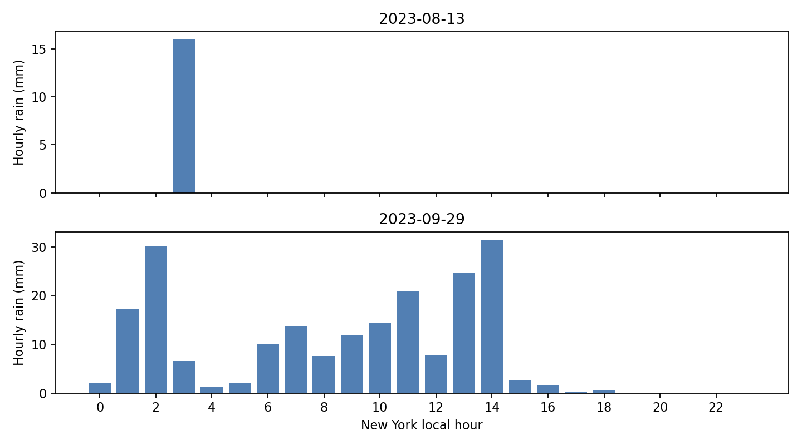
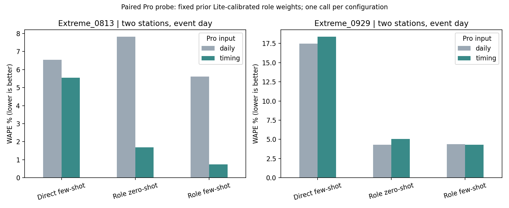

# 加入降雨时段：小规模结果

主要观察：8/13凌晨降雨的Pro角色预测改善，9/29没有一致改善。规则模型也有升有降，不能说加入时段必然更好。

这次补上了小时降雨、角色出发时段及两者重叠的暴露程度。规则 ABM 完成六个原任务重新训练和验证；Pro 只做两个事件、两个站点的成对测试。

重要区别：规则两组分别重新校准；Pro两组沿用同一套之前Lite拟合的外层权重，只重问决策。不能把这次当作已经完整训练的Pro模型，也不能用Pro与旧Lite的差异证明时段效果。每个Pro配置只推断一次，输出随机性未充分评估。

## 天气与设定

8/13日雨量16.002mm，集中在凌晨03时；9/29日雨量207.010mm，多小时持续降雨。各站共享JFK天气，日期沿用既有测试集，是事后诊断而非新的盲测。

12个角色仍保留四类票种×三种活动类型。通勤类工作日7—9时、周末9—11时；灵活事务10—16时；休闲工作日17—21时、周末12—20时。均为合成日程，不是观测到的个人习惯；这里只模拟单趟出发，不含返程。规则的时段暴露倍数上限固定为3，没有用测试分数调这个上限。实际雨后积水和停运未提供，因此未虚构。

## 规则 ABM：WAPE %

下表是全部测试窗口（正常天气7天、事件窗口5天），四个原站点。两个版本使用相同训练、验证、测试日期；分别按验证误差选择参数。

| task          |   rule_daily |   rule_timing |
|:--------------|-------------:|--------------:|
| Extreme_0729  |        12.12 |          7.67 |
| Extreme_0813  |         4.13 |          4.27 |
| Extreme_0929  |        13.54 |         11.49 |
| Extreme_1007  |        12.15 |         13.87 |
| Normal_School |         6.62 |          7.07 |
| Normal_Summer |         8.48 |          8.61 |

只看事件当天：

| task         |   rule_daily |   rule_timing |
|:-------------|-------------:|--------------:|
| Extreme_0729 |        41.17 |         16.77 |
| Extreme_0813 |         5.61 |          5.62 |
| Extreme_0929 |        49.45 |         41.91 |
| Extreme_1007 |        41.45 |         61.98 |

9/29时段版验证集选出的雨量系数为0，即这一组事实上忽略雨量，不能把误差下降解释为成功识别雨的时段。10/7事件日反而从41.45%升到61.98%，说明固定日程、暴露函数以及少量验证天气仍有局限。

日汇总版已核对能复现上一版规则结果。时段版同时重新拟合了参数，因此该比较是完整方法对比，不是单独替换一个测试特征的因果效果。

## Pro：同模型、同权重，只改变时段天气输入

只评估Pelham Bay Park（360）和77 St / R（37）。daily只有日汇总，timing额外给24小时雨量；few-shot示例的天气也同步增加小时雨量。角色两组都有同一份假设日程。下面为两个站点的WAPE，不与四站主实验直接横比。

|                                       |   daily |   timing |
|:--------------------------------------|--------:|---------:|
| ('Extreme_0813', 'direct_few')        |    6.54 |     5.55 |
| ('Extreme_0813', 'role_no_history')   |    7.82 |     1.69 |
| ('Extreme_0813', 'role_with_history') |    5.61 |     0.73 |
| ('Extreme_0929', 'direct_few')        |   17.48 |    18.37 |
| ('Extreme_0929', 'role_no_history')   |    4.29 |     5.06 |
| ('Extreme_0929', 'role_with_history') |    4.35 |     4.28 |

一个具体例子：8/13 general_0 的few-shot日汇总回复说“steady rain”，但实际雨在凌晨；加时段后改为“dry late morning”。这表明时段信息能纠正文字情景理解，不过该角色地铁概率从0.58变为0.56，并非每个角色都朝提高客流的方向变化。不能只凭理由文字判断预测正确。

看角色是否更少取消出行，可查group_choices.csv（按代表权重平均的地铁/不出行概率）；某组当天拟合规模为零时，群体加权概率留空，不伪造为零。具体理由和原始概率在pro_decisions.csv及压缩API日志。它们是模型选择，不是真实人的行为标签。两个站点共享同画像回复，因此不构成两个独立行为样本。

## 成本与复现

新增Pro请求104次，有效104次，失败0次；计入预算98,196 token，低于160,000上限。没有调用Lite或重新生成完整训练期角色回复。

四项时段测试通过：雨从夜间移到通勤时段能改变暴露；日程概率归一；小时雨量与原日量一致；目标客流不进入提示。离线检查同时核对原始API、两组权重一致、实际评分样本一致及日汇总规则结果复现。

运行方法与固定设定见[TIMING.md](TIMING.md)。下一步若正式比较，应在未见日期上补充事件，并重新校准Pro训练期；还需要检验日程假设、返程、局地雨量和服务中断。本次不自动扩展调用。
