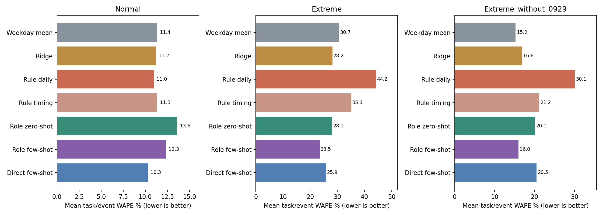
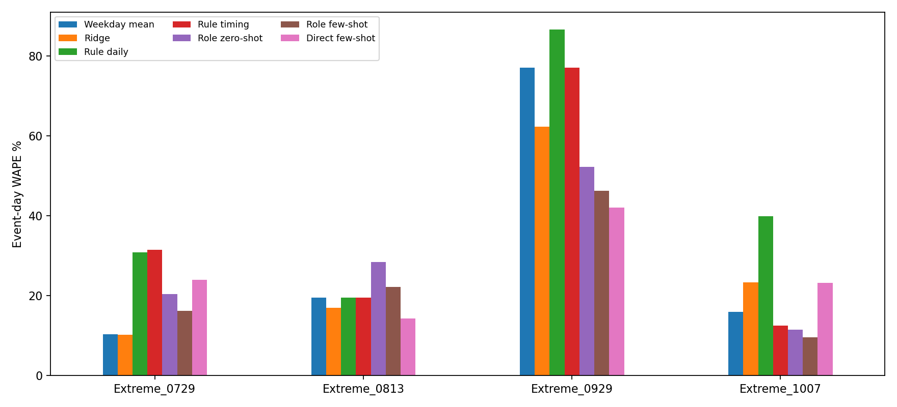

# 新站点独立Lite实验

Normal平均最低为Lite直接few-shot（时段）（10.30%）；四个Extreme事件平均最低为Lite角色few-shot（时段）（23.53%）；排除9/29后最低为星期均值（15.24%）。这是本轮单次推断结果，不代表稳定或显著优势。

本轮没有复用以往API回复、拟合权重或预测结果；模型配置保持不变。使用最新时段输入，重新生成训练、验证、测试阶段的角色概率并重新拟合外层规模。所有LLM结果来自本轮真实Lite API，不是聊天生成的替代数据。

## 主要比较

WAPE为绝对误差总和/真实客流总和，越低越好，不是分类准确率。Normal是两个正常天气任务WAPE的等权平均；Extreme是四个事件当天WAPE的等权平均，剔除9/29另列。每配置一次推断，不挑最好重复；未估计LLM重复波动。

| method                    | Normal     | Extreme    | Extreme_without_0929   |
|:--------------------------|:-----------|:-----------|:-----------------------|
| 星期均值                  | 11.35%     | 30.70%     | **15.24%**             |
| Ridge                     | 11.19%     | 28.19%     | 16.83%                 |
| 规则ABM（日汇总）         | 10.97%     | 44.23%     | 30.10%                 |
| 规则ABM（时段）           | 11.34%     | 35.15%     | 21.17%                 |
| Lite角色zero-shot（时段） | 13.61%     | 28.13%     | 20.08%                 |
| Lite角色few-shot（时段）  | 12.32%     | **23.53%** | 15.96%                 |
| Lite直接few-shot（时段）  | **10.30%** | 25.88%     | 20.48%                 |

## 分任务

| method                    |   Extreme_0729 |   Extreme_0813 |   Extreme_0929 |   Extreme_1007 |   Normal_School |   Normal_Summer |
|:--------------------------|---------------:|---------------:|---------------:|---------------:|----------------:|----------------:|
| 星期均值                  |           6.99 |          10.81 |          11.08 |          10.54 |           10.2  |           12.5  |
| Ridge                     |          11.08 |          11.18 |          11.7  |          15.38 |            8.88 |           13.49 |
| 规则ABM（日汇总）         |          11.14 |          10.81 |          11.84 |          15.23 |            9.43 |           12.5  |
| 规则ABM（时段）           |          11.12 |          11.44 |          11.08 |           8.97 |           10.2  |           12.48 |
| Lite角色zero-shot（时段） |           9.72 |          20.47 |          18.77 |          15.77 |           12    |           15.23 |
| Lite角色few-shot（时段）  |           8    |          13.04 |          13.84 |          10.74 |            9.73 |           14.9  |
| Lite直接few-shot（时段）  |           8.33 |          10.66 |          11.2  |          14.31 |            8.84 |           11.75 |

上表Extreme为含事件前后两天的整个5天窗口，不能代替下面的事件当天成绩。

| method                    |   Extreme_0729 |   Extreme_0813 |   Extreme_0929 |   Extreme_1007 |
|:--------------------------|---------------:|---------------:|---------------:|---------------:|
| 星期均值                  |          10.34 |          19.49 |          77.09 |          15.9  |
| Ridge                     |          10.22 |          16.99 |          62.26 |          23.29 |
| 规则ABM（日汇总）         |          30.89 |          19.49 |          86.64 |          39.91 |
| 规则ABM（时段）           |          31.51 |          19.46 |          77.09 |          12.52 |
| Lite角色zero-shot（时段） |          20.37 |          28.36 |          52.3  |          11.49 |
| Lite角色few-shot（时段）  |          16.15 |          22.13 |          46.26 |           9.59 |
| Lite直接few-shot（时段）  |          23.93 |          14.33 |          42.06 |          23.17 |

事件当天实际总量相对训练期同星期均值的变化（描述性对照，不是天气因果效应）：

| task         |   actual |   predicted |   actual_vs_training_weekday_pct |
|:-------------|---------:|------------:|---------------------------------:|
| Extreme_0729 |    18451 |     17973.3 |                             2.66 |
| Extreme_0813 |    13682 |     16096   |                           -15    |
| Extreme_0929 |     7812 |     13834   |                           -43.53 |
| Extreme_1007 |    15005 |     17162.3 |                           -12.57 |

## 数据与范围

|   station_complex_id | station_name     | borough   |
|---------------------:|:-----------------|:----------|
|                  385 | 176 St (4)       | Bronx     |
|                  292 | Fulton St (G)    | Brooklyn  |
|                  311 | 86 St (1)        | Manhattan |
|                  256 | Parsons Blvd (F) | Queens    |

| task          |   days |   train_days |   validation_days |   test_days |   observed_test_station_days |
|:--------------|-------:|-------------:|------------------:|------------:|-----------------------------:|
| Extreme_0729  |     31 |           19 |                 7 |           5 |                           20 |
| Extreme_0813  |     29 |           17 |                 7 |           5 |                           20 |
| Extreme_0929  |     25 |           13 |                 7 |           5 |                           19 |
| Extreme_1007  |     33 |           23 |                 5 |           5 |                           20 |
| Normal_School |     28 |           15 |                 6 |           7 |                           28 |
| Normal_Summer |     26 |           12 |                 7 |           7 |                           28 |

站点选择只依据7/1—7/19的训练期客流和完整性，排除此前四站，按各区中位客流取一站。9/29的86 St少一个小时，当天四站中只计三站；所有方法同样排除。其他测试日均四站。原日期划分不变，训练和验证早于测试。新站点不等于新时间段；这些事件此前已探索过，partner的全网实验也可能包含本轮站点，不应称为整个项目从未见过的盲测。

## 方法未调整

12个固定画像，票种与原先一样；老人/残障仍为源数据合并标签。规则效用、日程、时段暴露上限3、角色份额10%—60%、星期活跃度、参数候选、提示词、few-shot检索条数、Lite模型、温度0.3和输出250 token均不变。日汇总规则作为对照；LLM三种方法统一使用最新时段输入。zero-shot是LLM不接收历史示例，并非整个ABM没有训练。

各方法用训练/验证数据完成原有拟合和选参，测试不参与选参。角色在四站共享同画像的概率，仅外层规模不同；因此站点不是独立的LLM行为样本。真实天气是事后观测；合成画像和时段、机场代表性、未知服务中断仍是限制。一次抽样不能排除LLM随机性。

## 成本与复现

本轮API请求3,316次，有效回复3,238条，对应3,220个不同请求；计入预算3,824,653 token，硬上限5,000,000。含新API调用的已完成阶段耗时19.2分钟，包含已完成阶段的请求等待和拟合，但不含中断阶段的额外等待，不是完整墙钟时间。详见runtime.csv、budget.json；原始日志仅保留本地，不上传GitHub。

GitHub接收方运行`python reproduce_numeric.py`可重新拟合并核对已公开的数值结果，不需要密钥或原始日志；直接LLM复用已保存的预测数值，不代表重新推断。若本地有原始日志，则可运行`python run.py --offline`及`python report.py`完成原始回复溯源核验。联网重新调用需密钥位于上一级key.txt。本轮自己的缓存会复用，缺失且offline时直接报错。

最终核验还发现续跑时18个请求已有有效重试回复却又被调用；已按每个请求最早的有效回复离线重新拟合全部结果，后来的重复回复不用于分析，全部费用仍计入。没有按分数选择回复。

网络中断曾导致47次无响应连接失败；连接恢复后，工程层允许按相同请求哈希续跑，有效回复不重抽。所有失败日志及保守预算均保留，模型、提示及参数不变，变更记录在protocol.json。

核验包括：冻结文件哈希、请求哈希、概率合法性、所有预测可追溯到本轮API、相同评分样本、角色份额约束和保存权重的数值回放。没有根据本轮结果更改模型配置。

本次只公开代码和数值结果。原始API日志、原始回复文本与调用元数据未上传；公开文件的reason为占位说明。下面的本地核验结论来自本地完整证据，不能据此声称GitHub仓库已提供原始API记录。
