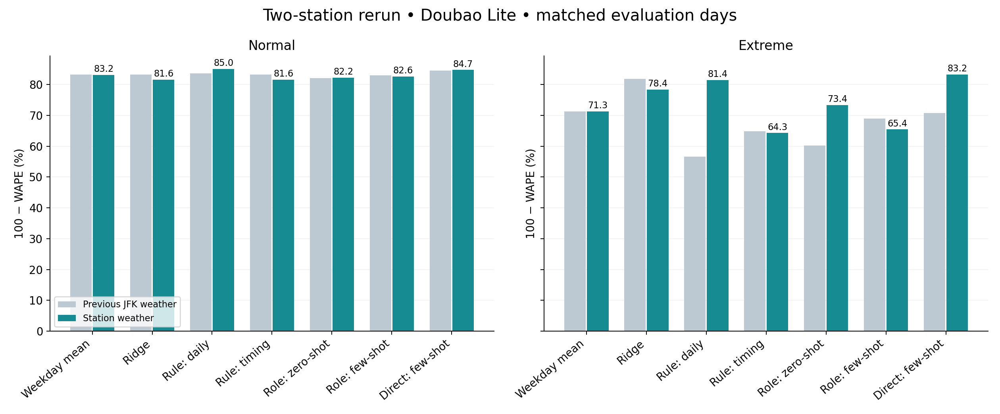
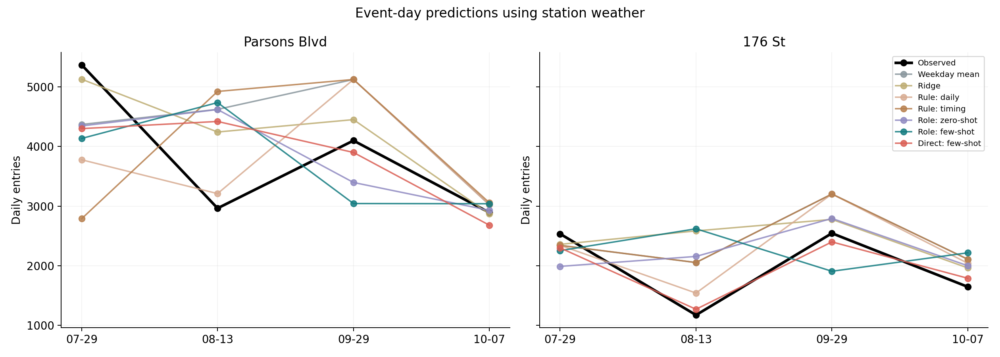

# 分站点天气重跑结果

**这两站上，直接 LLM 在原定 Extreme 事件日的平均表现最好；角色 few-shot 仍然不理想。新天气值得使用，但没有让所有方法一起提升。**

使用 Parsons Blvd（256，Queens）和 176 St（385，Bronx）。新天气源来自 Git 提交 `714cc5a`，本轮使用 Doubao Lite，重新调用并重新拟合，没有复用旧模型回复。两站共 84 个站点/任务/方法组合、462 条每日预测，全部完成。模型内部聚合、决策概率与人口权重检查通过。

## 相同测试日期的新旧对照

数值为 `100 × (1 − WAPE)`（百分比），越高越好，不是分类正确率。各列最优加粗。Normal 在两个任务内先汇总两站，再对任务等权平均；Extreme 在四个事件当天分别汇总两站，再对事件等权平均。测试共 28 个 Normal 站点日和 8 个事件站点日。

| 方法 | Normal 原天气 | Normal 新天气 | Extreme 原天气 | Extreme 新天气 |
|---|---:|---:|---:|---:|
| 星期均值 | 83.18 | 83.15 | 71.29 | 71.29 |
| Ridge | 83.26 | 81.57 | **81.84** | 78.35 |
| 规则 ABM：日汇总 | 83.61 | **85.03** | 56.57 | 81.41 |
| 规则 ABM：加入时段 | 83.20 | 81.60 | 64.89 | 64.28 |
| 角色 LLM：zero-shot | 82.01 | 82.24 | 60.14 | 73.35 |
| 角色 LLM：few-shot | 82.92 | 82.63 | 68.96 | 65.42 |
| 直接 LLM：few-shot | **84.50** | 84.72 | 70.69 | **83.24** |

- 直接 LLM 的 Extreme 得分由 70.69 升到 83.24，增加 12.54 个百分点；Normal 基本不变。
- 角色 zero-shot 的 Extreme 得分提高，但角色 few-shot 从 68.96 降到 65.42。历史输入没有保证更好的决策。
- 规则 ABM 日汇总改善很大；加入时段的规则版本仍较差。因此时段信息不是必然有效，当前假设出发时间与暴露处理还可能不符合真实出行。
- 这里只是两站、四个事件的结果，尚不能据此断言某方法对全网都最好。

## 天气核查与事件含义

全表 424 站、1,251,648 行，与源气象站独立重算一致（误差不超过六位小数舍入）。它是 6 个气象站的空间插值，不是地铁站实测。缺雨量的 7/14、7/19、8/14 被排除，没有填零。JRB 的降雨仍有疑点，所选两站均不使用它。

| 日期 | 原统一 JFK 雨量 mm | Parsons Blvd mm | 176 St mm |
|---|---:|---:|---:|
| 2023-07-29 | 16.26 | 9.02 | 1.26 |
| 2023-08-13 | 16.00 | 23.98 | 15.98 |
| 2023-09-29 | 207.01 | 165.17 | 109.35 |
| 2023-10-07 | 47.75 | 32.84 | 16.17 |

因此保留原任务名字不等于当地仍符合原天气类别。原 Normal 的 28 个测试站点日中，3 个本地雨量超出小雨阈值；原 Extreme 的 8 个站点日中，只有 5 个满足日雨量 ≥25 mm 或小时峰值 ≥10 mm。

补充按这些本地阈值筛选测试样本，不重新训练：

| 方法 | 本地 Normal 子集 | 本地 Extreme 子集 |
|---|---:|---:|
| 星期均值 | 83.45 | 69.60 |
| Ridge | 81.20 | 75.13 |
| 规则 ABM：日汇总 | 84.62 | 85.11 |
| 规则 ABM：加入时段 | 82.38 | 66.77 |
| 角色 LLM：zero-shot | 82.93 | 73.54 |
| 角色 LLM：few-shot | 81.68 | 63.86 |
| 直接 LLM：few-shot | 84.44 | 83.32 |

在更小的本地 Extreme 子集上，规则 ABM 日汇总为 85.11%，直接 LLM 为 83.32%，排名反转。**样本及天气定义会影响结论；不能只展示有利于 LLM 的那张表。** 这份子集评分仅用于敏感性检查，不替代重新设计本地天气训练/验证/测试任务。

## 四个事件的预测

例如 176 St 的 8/13：实际 1173 人次，直接 LLM 1270；角色 few-shot 2620。角色方法高估客流，并非所有失败都是“夸大暴雨、取消出行过多”。逐条结果见 [event_details.csv](res/event_details.csv)。

## 比较的边界

本轮保持模型公式、画像、提示词与搜索范围，使用本站天气重新调用、拟合和选参。但这不是严格只改变天气的配对干预：缺失日排除改变了部分训练历史；旧版四站共同选超参数，新版每站独立验证选参；LLM 回复也有随机性。故新旧分差不能全部解释为天气数据的因果收益。

角色历史继续采用原四站归一化票种客流，配套目标站天气；不是个人真实选择记录。天气为已知的事后观测，而非真实提前发布的天气预报。

## 调用与复现

实际累计 **6,880,913 token**（输入 6,563,548、输出 317,365），共 6,091 次尝试，6,042 次有效回复；49 次无效格式/约束回复已经计入用量。低于本轮放宽后的 750 万上限。原始 API 证据仅保存在本机，不上传。

调用分项见 [api_cost.csv](res/api_cost.csv)，运行说明见 [README](README.md)，逐任务结果见 [task_metrics.csv](res/task_metrics.csv)，逐站结果见 [station_task_metrics.csv](res/station_task_metrics.csv)。
