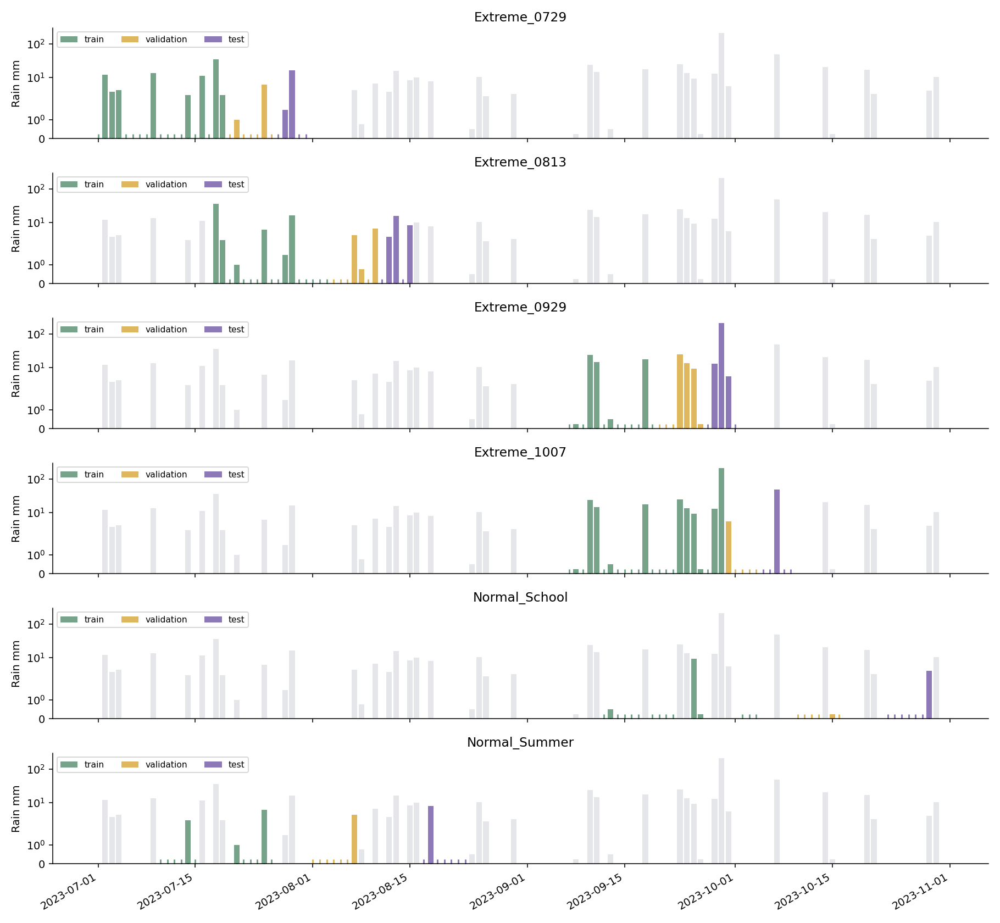
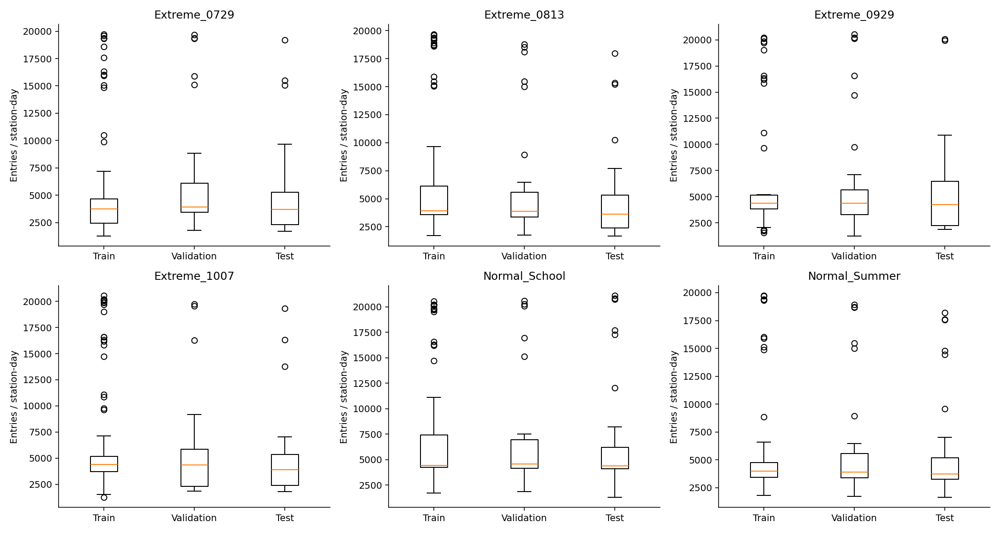
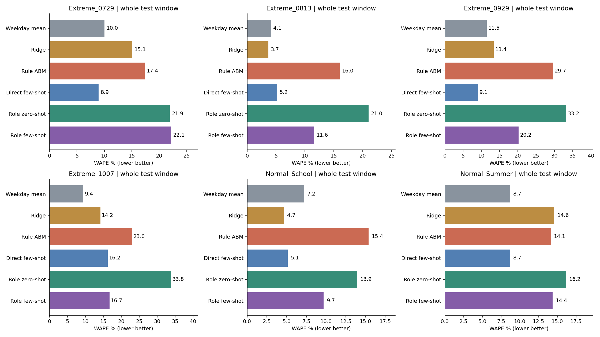
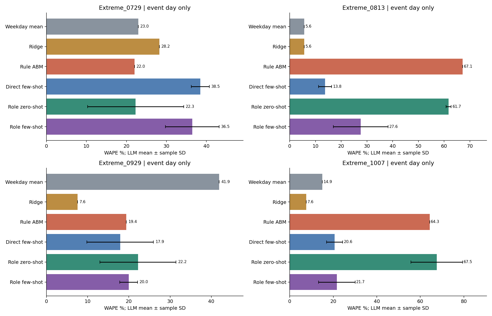
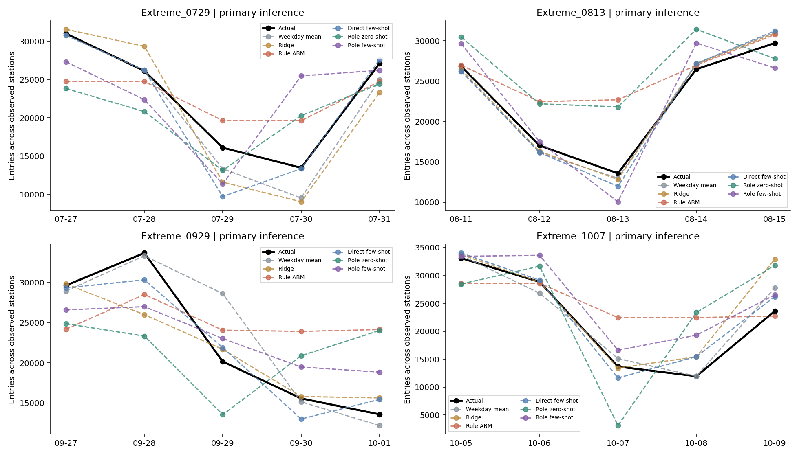
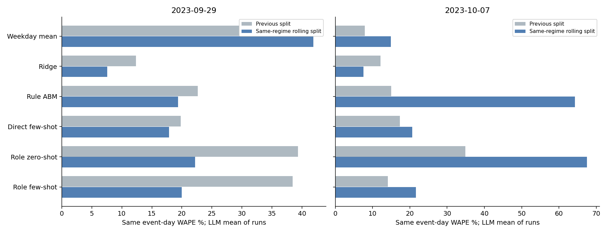
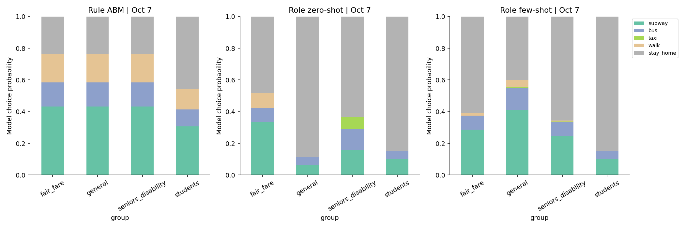
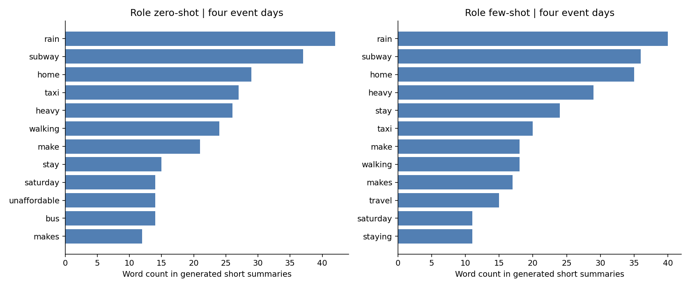
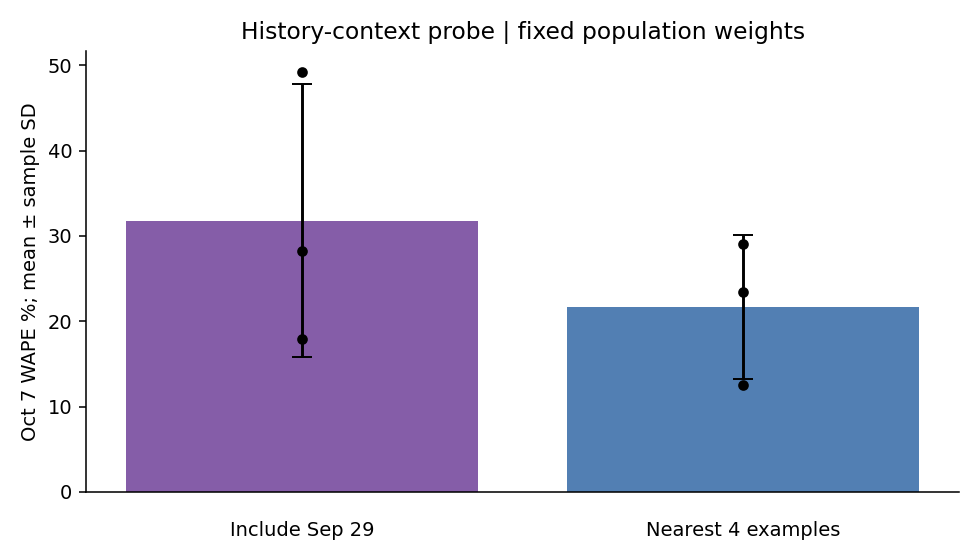
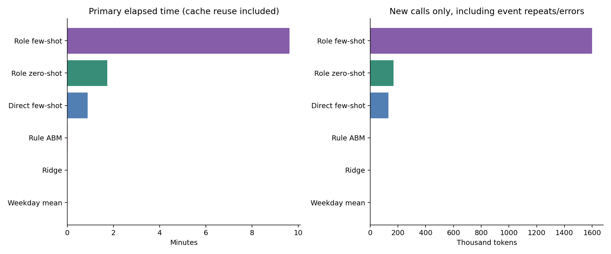

# 本轮结果：同季节训练与滚动事件测试

**重新划分确实修复了学生规模过小的问题，但没有让所有预测都变好。** 9月29日的角色few-shot有所改善，10月7日反而变差；Ridge在这两个秋季暴雨日都比角色方法准确。因此，不能把上一版的全部问题都归因于划分，也不能概括为“LLM遇到暴雨一定过度反应”。

本轮只调整数据划分，保留同样的六种方法、角色、提示、历史检索和参数候选。额外做了一个固定权重的历史示例小对照。没有根据测试分数重选参数，也没有只保留最好的调用。

## 1. 数据怎么分

仍是现有2023年7—10月数据，四个站点：Pelham Bay Park（360）、77 St / R（37）、23 St / F-M（228）、Northern Blvd（269）。不是新增采集的数据。

- **暑假 Normal**：训练7/10—7/26，验证8/1—8/7，测试8/17—8/23。
- **学期 Normal**：训练9/12—10/4，验证10/10—10/16，测试10/23—10/29。
- **Extreme**：分别测试7/29、8/13、9/29、10/7，每次带前后两天。每轮只用之前的观测，并在暑假、学期内单独拟合。10/7训练包括9/29；没有将未来事件换进过去的训练集。

Normal范围内过滤掉较强降雨及强雨事件前后两天，所以训练日并不全部连续；两个Normal测试周均连续7天。逐日清单在 [dates.csv](res/dates.csv)，各Extreme训练/验证范围见 [PROTOCOL](PROTOCOL.md)。

| 任务 | 训练/验证/测试天数 | 测试有效站点日 | 测试平均客流/站/日 |
| --- | --- | --- | --- |
| Normal_Summer | 12 / 7 / 7 | 28 | 6062 |
| Normal_School | 15 / 6 / 7 | 28 | 7071 |
| Extreme_0729 | 19 / 7 / 5 | 20 | 5687 |
| Extreme_0813 | 17 / 7 / 5 | 20 | 5680 |
| Extreme_0929 | 13 / 7 / 5 | 19 | 5928 |
| Extreme_1007 | 23 / 5 / 5 | 20 | 5557 |

每种方法共135个有效测试站点日；事件当天为4事件×4站=16个观测，但只有4个天气事件，不能当16个独立暴雨样本。学生平均进站量在学期Normal训练/测试约317/297，已不再是暑假几十次对开学几百次。

训练/测试日降雨范围：7/29为35.3/16.3mm，8/13为35.3/16.0mm，9/29为23.9/207.0mm，10/7为207.0/47.8mm（前者为训练最大，后者为事件当天）。因此前三个范围内测试是7/29、8/13、10/7，9/29单列为超范围压力测试。前两次是短时强雨，不应都写成日累计大暴雨。

## 2. 准确率

下面是WAPE，越低越好，等于绝对误差总和/真实客流总和。不是“100减WAPE就是分类准确率”。MAE、RMSE、偏差方向和误差不超过20%的比例均在结果CSV中。

**Normal：一次主推断，未重复调用。**

| 方法 | 暑假 Normal | 学期 Normal |
| --- | --- | --- |
| 星期均值 | 8.69% | 7.20% |
| Ridge | 14.59% | 4.68% |
| 规则 ABM | 14.15% | 15.38% |
| 直接 few-shot | 8.69% | 5.12% |
| 角色 zero-shot | 16.18% | 13.94% |
| 角色 few-shot | 14.38% | 9.69% |

学期里角色few-shot优于规则ABM和角色zero-shot，但仍不及Ridge和直接few-shot。暑假里角色few-shot与规则ABM相近，星期均值已经很有竞争力。

**只看事件当天：LLM为3次推断的平均WAPE，规则和数值方法为固定结果。**

| 方法 | 7/29 短时强雨 | 8/13 短时强雨 | 9/29 特大暴雨 | 10/7 强降雨 |
| --- | --- | --- | --- | --- |
| 星期均值 | 22.98% | 5.61% | 41.91% | 14.90% |
| Ridge | 28.24% | 5.61% | 7.56% | 7.59% |
| 规则 ABM | 22.04% | 67.14% | 19.38% | 64.30% |
| 直接 few-shot | 38.47% | 13.76% | 17.88% | 20.64% |
| 角色 zero-shot | 22.31% | 61.71% | 22.21% | 67.54% |
| 角色 few-shot | 36.47% | 27.57% | 19.95% | 21.66% |

9/29、10/7的Ridge都约7.6%，并没有因为更复杂的角色设定而失去竞争力。7/29直接few-shot在整个五天窗口的误差只有8.9%，但事件当天平均38.5%；这说明必须把事件当天单独拿出来，不能用周围正常日稀释问题。

图中误差条是3次推断的样本标准差，不是置信区间；训练权重固定，没有做3次完整重训。全部五天窗口的曲线见下图，主调用与重复结果分别保存，未用重复平均替换主预测。

## 3. 和旧版相比，哪些问题解决了

下表严格使用相同事件、相同站点，LLM两版都取3次平均；Normal测试日期不同，不把它们的分数直接当作新旧提升。

| 方法 | 9/29 旧→新 | 10/7 旧→新 |
| --- | --- | --- |
| 星期均值 | 29.55% → 41.91% | 7.93% → 14.90% |
| Ridge | 12.34% → 7.56% | 12.14% → 7.59% |
| 规则 ABM | 22.66% → 19.38% | 15.01% → 64.30% |
| 直接 few-shot | 19.82% → 17.88% | 17.34% → 20.64% |
| 角色 zero-shot | 39.33% → 22.21% | 34.89% → 67.54% |
| 角色 few-shot | 38.44% → 19.95% | 14.07% → 21.66% |

**学生规模上限问题基本解除。** 旧Extreme的学生权重太小，即便地铁概率全为1，也会留下约75%—76%的学生低估。本轮两个秋季窗口的对应下限为0—0.32%。这支持“暑假训练不能直接标定开学后的固定学生规模”这个解释。

但学生预测仍不精确：角色few-shot在9/29窗口的学生WAPE约43.8%，10/7窗口约50.4%；学期Normal约20.5%。规模上限解除不等于正确学会每天的学生行为。有效规模也仍是训练系数，不能解释成真实学生人数。

**新划分不是万能修复。** 10/7的规则ABM、角色zero-shot和角色few-shot都比旧版差。较短的验证窗口、周末行为、固定人物和权重的识别问题仍会影响结果；不能用这几个事件唯一确定是哪项原因。

## 4. 还可以说LLM overreact吗

更准确的是：**某些角色配置会出现过强的回避，也会出现相反方向的误差，而且对历史示例与调用波动敏感。**

- 9/29角色zero-shot三次平均低估约22.2%；角色few-shot却平均高估约15.3%。
- 8/13角色zero-shot平均高估约61.7%，不符合“所有暴雨都过度减少出行”。
- 10/7角色zero-shot平均WAPE约67.5%，但三次中低估、高估都有；只看均值偏差会掩盖这种不稳定。

例如10/7主调用中，普通票价、固定活动角色的地铁概率，zero-shot为0.05，few-shot为0.45。zero-shot解释为暴雨加周六让其待在家；few-shot结合历史后保留更多地铁出行。这些文字帮助理解模型输出，但不是实际乘客的心理证据，也不是可验证的内部思考过程。

群体客流预测在 `group_predictions.csv`，概率在 `group_actions.csv`，角色原文在 `reason_examples.csv`。票种是人群代理标签；老人和残障仍因原始数据合并而不能按真实人数拆开。

## 5. 历史在训练集里，LLM一定看得到吗

**不一定。** 10/7训练包括9/29，但原来的4条角色few-shot示例选中了9/10、9/18、9/23、9/24，没有选中9/29。因为检索同时考虑雨量、星期和学期状态。直接few-shot的8条示例则包括9/29。实际参考日已输出为 `history_examples.csv`。

为此固定10/7已训练权重，只把角色few-shot的一条示例换成9/29，仍保持4条历史，调用3次。结果：平均WAPE从21.7%变成31.8%，波动也更大。**强行加入最极端历史，没有在这次小对照中改善预测。** 只有一个事件、3次推断，不能据此断言强雨历史一定有害；它说明“多给一个大暴雨例子就能校正模型”也不成立。这是测试提示的小对照，不替换主结果，详见 [CONTEXT_PROBE](CONTEXT_PROBE.md)。

## 6. 成本、复现和交付

新增 **1,901,886 token**，2,504次API请求；另复用了988条完全相同请求的历史真实回复。全部使用Lite，包含失败重试与补充实验，低于200万上限，没有再调用Pro。

| 路线 | 新增API调用 | 新增token | 平均单次API秒数 |
| --- | --- | --- | --- |
| 直接 few-shot | 168 | 132,774 | 2.58 |
| 角色 zero-shot | 346 | 168,276 | 2.93 |
| 角色 few-shot | 1990 | 1,600,836 | 2.91 |

主实验阶段合计约12.2分钟，事件重复和示例对照约2.1分钟；不含准备数据和画图。阶段耗时含缓存，不能当作所有请求重新发送时的冷启动耗时。单次API平均延迟仅按本轮实际请求计算，API服务秒数相加也不等于并发运行墙钟时间。

四项测试通过；30组数值/ABM结果已从训练集、验证选择和保存策略回放，最大误差约7.3e-12。主调用、事件重复及示例对照都有真实请求记录，概率约束、预算和相同评分样本检查通过。

网页数据已按本轮结果更新：445个当前站点节点、1121条简化有向边、80个合成人物、18条抽样地铁旅次，路径检查通过。目的地、时刻是演示设定，不是真实OD；当前网络不保证还原2023年临时关闭。

当前项目只保留 `llm_based_abm/current/`；旧版在Git历史提交 `7f973e8` 中可恢复。运行方式、CSV接口和网页接口见 [README](README.md)。

## 能够支持的结论

这次证据更支持：**训练期的季节代表性、历史示例选择和群体到个体的转换，会明显影响角色型LLM的预测；合理的角色描述和解释文本，并不自动带来准确或稳定的客流预测。**

这是对已探索过的4个月数据重新划分的回顾性研究，只有4站、4个事件，且天气使用当天实测值。它不是全新盲测或真实提前一天预报，不能将结果推广为所有城市、所有LLM或所有极端天气下的统一规律。滚动评估依据与文献边界见 [PROTOCOL](PROTOCOL.md)。
